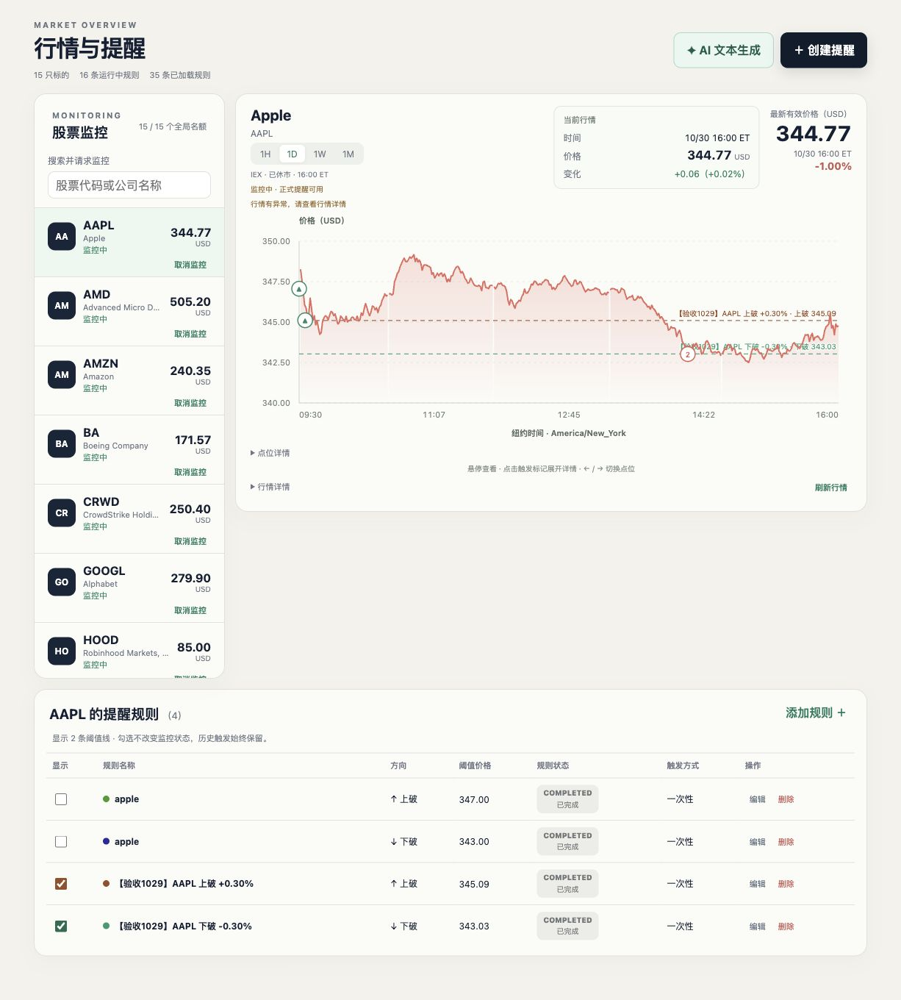
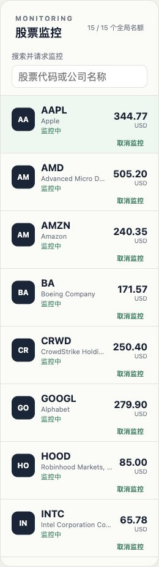
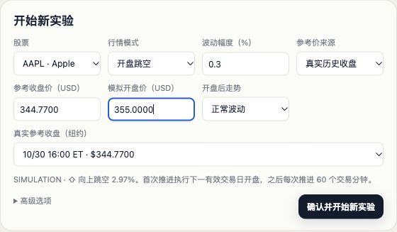
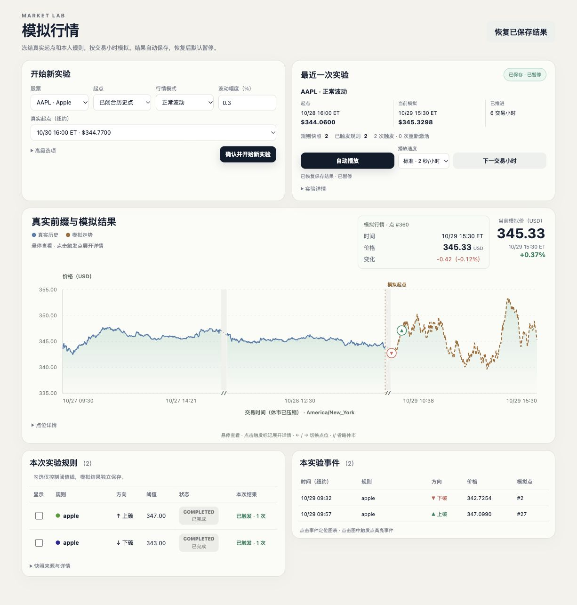
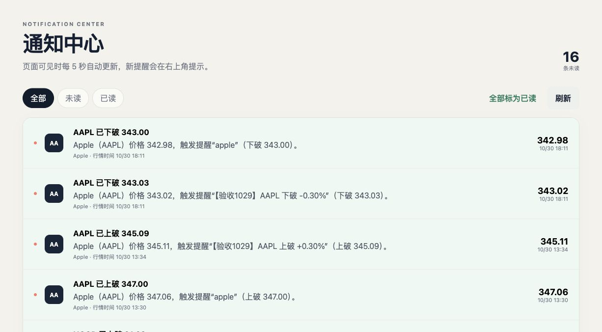
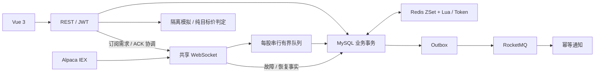

# PricePulse

> 美股实时目标价提醒与隔离模拟实验平台，关注行情可信度、事务一致性与可靠通知。

**当前发布：V11／V12，数据库版本 V12。** REAL 与新模拟实验统一采用一次性目标价规则：可信价格满足目标后 `ACTIVE → COMPLETED`，取消使用 `DELETED`。[当前版本、验收与已知边界](docs/release/v11-v12/status.md)


## 实际界面



现有图片为 **V2.1 历史实拍图**，账户侧栏已裁除；展示图表、规则表和页面布局，旧规则选项以当前 V12 说明为准。股票列表与规则分别滚动，两列底部对齐。

<details>
<summary>更多实际页面：监控入口、模拟与正式通知</summary>

**股票监控与搜索入口**（拍摄时名额 15/15，未提交添加请求）



**开盘跳空参数**（仅填写、未创建实验；不冒充触发结果）



**已保存的普通模拟**（真实前缀与既有触发；旧生成器实验在 V12 中只读）



**正式通知中心**（历史价格提醒；未展示 V11 新增的监控中断／恢复通知）



</details>

[截图来源与缺失场景](docs/v2.1-presentation.md)：尚未补拍 V12 页面、搜索添加成功及跳空触发结果，不以合成图替代真实界面。

## 核心功能

- **行情与提醒**：1H／1D／1W／1M 图表，纽约时间、休市断轴、多规则阈值线和历史触发定位。
- **股票监控**：搜索 Alpaca 美股及 ETF，添加即提交个人监控需求；多用户按股票代码共享订阅，实际 ACK 后显示监控中，取消时确认并原子停用本人相关规则。
- **一次性目标价**：`ABOVE` 当前可信价 ≥ 阈值，`BELOW` 当前可信价 ≤ 阈值；创建／编辑和恢复首笔复用相同判定，已完成规则不能重新激活。
- **可靠通知**：价格提醒保留真实成交、实际确认时间及规则快照；连接中断与恢复使用独立通知类型，已确认的队列丢弃也会告警。
- **隔离模拟**：冻结历史、规则、交易日历与 seed；支持上涨、下跌、震荡、正常波动和开盘跳空，幂等推进与自动播放。旧实验保留只读，实验事件不进入正式通知。

不再提供 REPEAT、COOLDOWN 或重新激活。另有 JWT 账户隔离和经用户确认的 AI 规则草稿；不提供交易下单。

## 系统架构



单股成交按顺序处理；股票行锁保护去重、水位与规则生效顺序。持锁后查询 Redis 候选，再由 MySQL 权威回查并条件完成规则，触发与 Outbox 同事务提交。Redis 可重建，模拟运行状态独立保存。[当前设计与源码入口](docs/release/v11-v12/status.md#当前架构与源码)

## 后端技术亮点

1. **可重建目标索引**：Redis ZSet＋Lua 仅保存 ACTIVE 目标，含等号边界及同价命中；MySQL Token、索引重建和权威回查共同保护正确性。
2. **事务与消息幂等**：股票锁、成交唯一键和时间水位保护接入；`ACTIVE` 条件更新、触发与 Outbox 原子提交，租约／退避／至少一次投递结合通知唯一约束完成可靠通知。
3. **共享订阅与恢复**：全局去重预算、连接代次和持久化意图版本协调 ACK；恢复首笔按真实价格确认达标，监控故障跨重试计时、合并告警并在恢复后闭合。
4. **真实／模拟隔离**：共用纯目标价判定，分别保存状态；冻结输入、请求幂等、旧实验只读及独立模拟事件均有回归。

V11／V12 发布回归通过 **144 单元、143 隔离集成、52 前端测试**，TypeScript 与构建通过。[main CI](https://github.com/originalEzra/PricePulse/actions/runs/41268709113)

模拟实验替换无响应的前端修复另通过 **56 项前端测试**及类型／构建检查，已仅更新前端，后端与数据库版本保持。[修复记录](docs/release/v11-v12/status.md#前端修复)

2026-11-03 开市只读样本覆盖十五股、**19,618 笔已处理 REAL 成交及 7 条恢复后确认提醒**，正式通知唯一落库。自然开盘跳空、告警及时性及 IEX 1006 仍保留验收边界；30 秒是故障告警门槛，不是送达 SLA。[验收口径](docs/release/v11-v12/status.md#验证结果与边界)

旧规则模型的 MySQL／Redis 对照及性能负面结果保留在文档中，不作为当前一次性模型的容量或吞吐承诺。

## 快速启动

需要 JDK 21+、Node.js 22.12+、Docker Compose。以下用于**全新本地环境**；已有数据库先按 [V11／V12 迁移方案](docs/once-only-model/migration-plan.md)核对兼容性。

```bash
docker compose up -d
cp -n docs/examples/application-local.example.yml src/main/resources/application-local.yml
export JWT_SECRET="$(openssl rand -hex 32)"
./mvnw spring-boot:run -Dspring-boot.run.profiles=local
```

另一个终端：

```bash
cd frontend
npm ci
npm run dev
```

访问 <http://127.0.0.1:5173>，新环境后端默认 `18080`。若使用其他后端端口，在私人 `frontend/.env.local` 配置 `PRICEPULSE_BACKEND_URL`。新库自动应用 V1–V12；真实行情、正式写入、动态监控、MQ 与 AI 默认关闭，按[配置与启动说明](docs/local-start.md)启用。

## 更多文档

- [当前 V11／V12：设计、源码、发布与验收](docs/release/v11-v12/status.md)
- [一次性模型迁移方案](docs/once-only-model/migration-plan.md)与[离线回归明细](docs/once-only-model/acceptance.md)
- [容量、轮询、超时、配额与数据保留审计](docs/capacity-and-time-boundaries.md)（建议项不代表已经实现）
- [历史 MySQL B+ 树／Redis 对照及固定回放](docs/performance/v2.1-rule-selection-2026-10-31/report.md)
- [历史 REAL 队列／事务性能与局部批量优化](docs/performance/realtime-processing/report.md)
- [历史 V2.1 架构](docs/v2.1-final-architecture.md)、[API 设计](docs/v2-api-contracts.md)与[求职材料](docs/v2.1-career-summary.md)（旧规则语义以当前版本说明为准）
