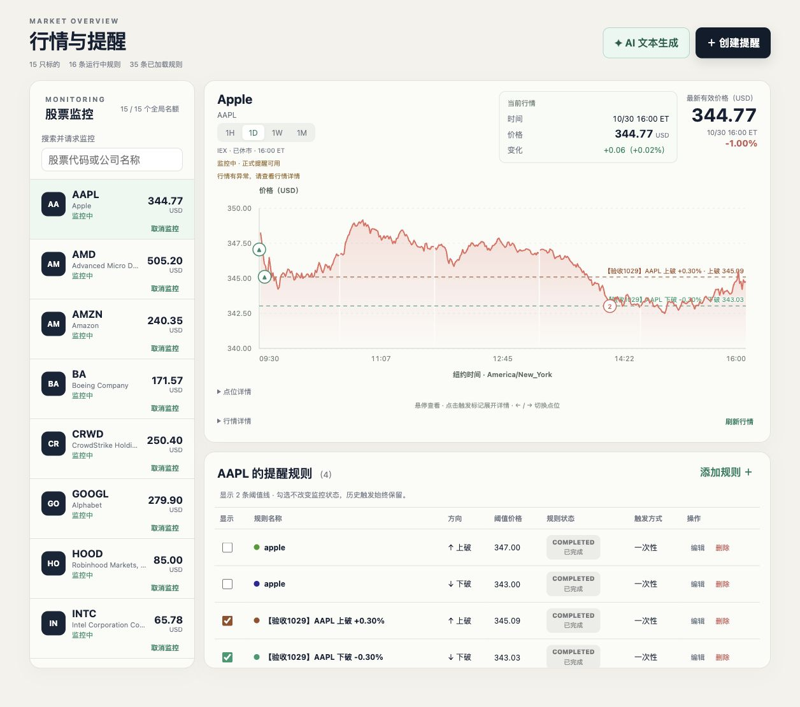
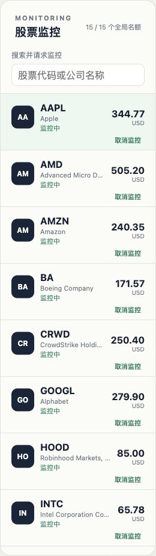
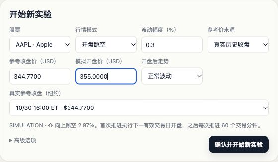
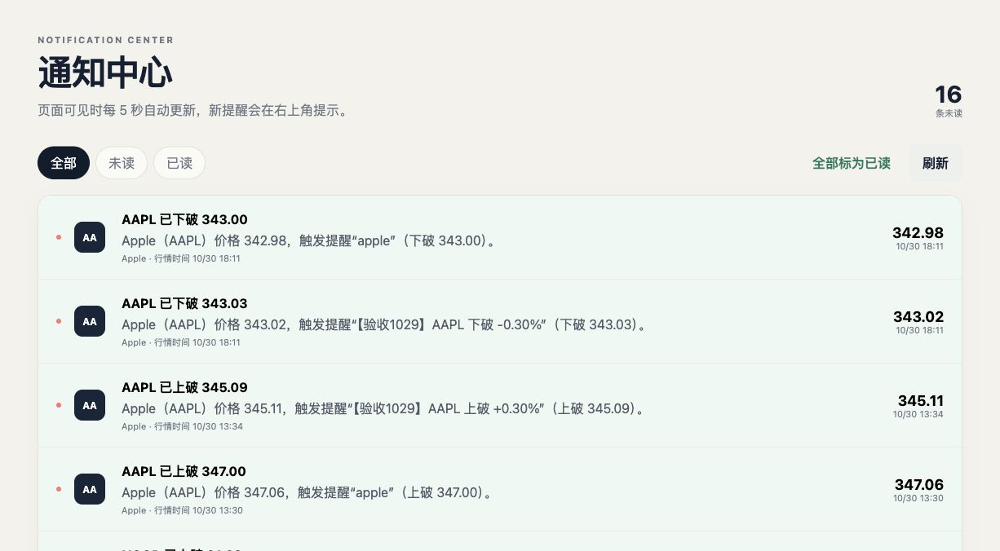
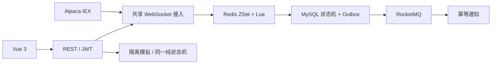

# PricePulse

> 美股实时价格提醒与隔离模拟实验平台，关注价格穿越、规则状态与可靠通知。


## 实际界面



当前 V2.1 实际运行截图，账户侧栏已裁除。股票列表独立滚动，规则紧接图表、约显示 3–4 行并支持表内滚动，两列底部对齐。保留真实休市状态与异常提示。

<details>
<summary>更多实际页面：监控入口、模拟与正式通知</summary>

**股票监控与搜索入口**（15/15 名额；未提交搜索或添加请求）



**开盘跳空参数**（仅填写、未创建实验；不冒充触发结果）



**已保存的普通模拟**（真实前缀、模拟走势及既有触发；非跳空实验）


**正式通知中心**（既有真实提醒，未操作已读）



</details>

[截图来源与未取得场景](docs/v2.1-presentation.md)：本轮不新增订阅或覆盖保存实验，搜索结果／添加成功和跳空触发结果图仍缺，未使用合成图替代。

## 核心功能

- **行情与提醒**：1H／1D／1W／1M 图表，纽约时间、休市断轴、多规则阈值线和历史触发定位。
- **股票监控**：搜索美股及 ETF，个人列表持久化；多用户共享上游订阅，实际确认后才显示监控中。
- **规则与通知**：上破／下破、一次性／重复、冷却与重新激活，通知保留触发时规则快照。
- **隔离实验**：冻结历史、规则与 seed，模拟交易时钟和开盘跳空，支持保存恢复与幂等推进，结果不进入正式通知。

另有 JWT 账户隔离和经用户确认的 AI 规则草稿；不提供交易下单。

## 系统架构



MySQL 保存业务事实，Redis 是可重建的候选索引；真实接入与模拟实验共享判定语义，分别保存运行状态。[详细架构与源码入口](docs/v2.1-final-architecture.md)

## 后端技术亮点

1. **区间候选匹配**：复用生产 ZSet＋Lua，与 MySQL B+ 树做 1,000–50,000 规则对照，集合零差异。10 万笔固定回放减少 **21.04%** 规则 SELECT；相对同价 SQL 短路仅再减少 **1.31%**，加入回查后选择层耗时更高。[完整数据与取舍](docs/performance/v2.1-rule-selection-2026-10-31/report.md)
2. **可靠通知**：规则、触发与 Outbox 同事务提交；租约、退避与至少一次投递结合消费唯一约束，支持失败恢复。
3. **共享行情订阅**：按代码去重、全局预算、连接代次及意图版本协调，取消个人监控与本人规则软删除原子提交。
4. **状态与隔离**：纯状态机复用于真实／模拟；冻结输入、独立存储、请求幂等与进程恢复均有隔离回归。

## 快速启动

需要 JDK 21+、Node.js 22.12+、Docker Compose。以下用于新的本地环境；已有实例按[配置与运行说明](docs/local-start.md)操作。

```bash
docker compose up -d
cp -n docs/examples/application-local.example.yml src/main/resources/application-local.yml
export JWT_SECRET="$(openssl rand -hex 32)"
./mvnw spring-boot:run -Dspring-boot.run.profiles=local
```

另一个终端：

```bash
cd frontend
npm ci
npm run dev
```

访问 <http://127.0.0.1:5173>。真实行情和 AI 默认关闭，私人配置方式见[启动文档](docs/local-start.md)。

## 更多文档

- [系统架构与源码](docs/v2.1-final-architecture.md)
- [MySQL B+ 树／Redis 对照、固定回放与原始数据](docs/performance/v2.1-rule-selection-2026-10-31/report.md)
- [V2.1 验收与外部待验边界](docs/v2.1-final-delivery.md)
- [API 契约](docs/v2-api-contracts.md)
- [Java 后端简历与面试材料](docs/v2.1-career-summary.md)
