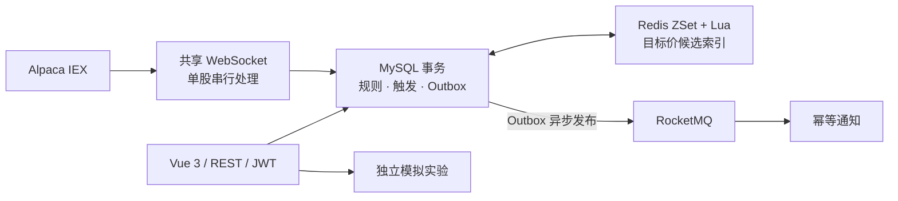

<div align="center">

<h1>PricePulse</h1>

<p>美股实时行情、目标价提醒与模拟实验平台</p>


<p>
  <a href="#功能">功能</a> ·
  <a href="#系统架构">系统架构</a> ·
  <a href="#后端技术亮点">后端技术亮点</a> ·
  <a href="#快速启动">快速启动</a>
</p>

</div>

## 产品界面


<details>
<summary>查看通知中心</summary>


</details>

## 功能

| 功能 | 说明 |
| --- | --- |
| 股票监控 | 搜索美股及 ETF，添加个人监控；多用户共享行情订阅，展示订阅确认状态。 |
| 行情图表 | 1H／1D／1W／1M 视图，纽约时间、休市断轴、多条目标价线与触发点定位。 |
| 目标价提醒 | 可信现价达到或高于上方目标、达到或低于下方目标时提醒一次，保留成交价格和规则快照。 |
| 模拟实验 | 基于真实历史模拟上涨、下跌与震荡，支持自定义开盘跳空、自动播放、暂停和保存恢复。 |
| 通知中心 | 查看价格提醒、监控中断与恢复通知，管理已读状态。 |
| AI 规则草稿 | 用自然语言描述提醒需求，生成结构化草稿，经用户确认后创建规则。 |

## 系统架构



MySQL 保存业务事实，Redis 提供可重建的规则候选索引。真实行情与模拟实验共用目标价判定，分别保存运行状态与事件。

## 后端技术亮点

1. **Redis ZSet + Lua 候选匹配**

   将 ACTIVE 规则按方向与目标价组织为有序索引，Lua 原子校验版本并筛选候选 ID，再由 MySQL 权威回查。索引缺失或 Token 不一致时自动重建。[源码](src/main/java/com/ezra/pricepulse/matching/RuleIndex.java)

2. **MySQL 事务与 Outbox 可靠通知**

   股票级行锁协调行情处理与规则变更，条件更新保证规则只完成一次；规则、触发记录与 Outbox 同事务提交。发布端租约与退避重试、RocketMQ 至少一次投递和消费端唯一约束共同避免重复通知。[源码](src/main/java/com/ezra/pricepulse/alert/AlertEvaluationService.java)

3. **共享订阅与行情顺序处理**

   多用户按股票代码共享一条上游连接，通过持久化需求、意图版本和 ACK 协调订阅名额。每股使用单线程有界队列，不同股票并行；成交唯一键、纳秒水位和连续性标记处理重复、乱序与重连恢复。[源码](src/main/java/com/ezra/pricepulse/market/RealMarketRuntime.java)

4. **真实／模拟隔离与幂等推进**

   实验冻结历史、规则快照、交易日历与 Seed，使用独立存储和索引。推进请求以幂等键与版本校验保护，重试保留原参数，模拟事件独立于正式通知链路。[源码](src/main/java/com/ezra/pricepulse/simulation/SimulationIsolationService.java)

## 快速启动

**环境要求：** JDK 21+、Node.js 22.12+、Docker Compose。

### 1. 启动后端

```bash
git clone https://github.com/originalEzra/PricePulse.git
cd PricePulse

docker compose up -d
cp -n docs/examples/application-local.example.yml src/main/resources/application-local.yml
export JWT_SECRET="$(openssl rand -hex 32)"

./mvnw spring-boot:run -Dspring-boot.run.profiles=local
```

### 2. 启动前端

在项目根目录另开一个终端：

```bash
cd frontend
npm ci
npm run dev
```

浏览器访问 [http://127.0.0.1:5173](http://127.0.0.1:5173)，后端默认端口为 `18080`。

真实行情、消息通知和 AI 按需配置，详见[本地启动与配置](docs/local-start.md)。

## 文档

- [本地配置](docs/local-start.md)
- [核心设计与源码导航](docs/release/v11-v12/status.md#当前架构与源码)
- [回归测试](scripts/run-real-pipeline-checks.sh)
- [Redis／MySQL 性能实验](docs/performance/v2.1-rule-selection-2026-10-31/report.md)
- [容量与时间边界](docs/capacity-and-time-boundaries.md)
- [数据库迁移说明](docs/once-only-model/migration-plan.md)
