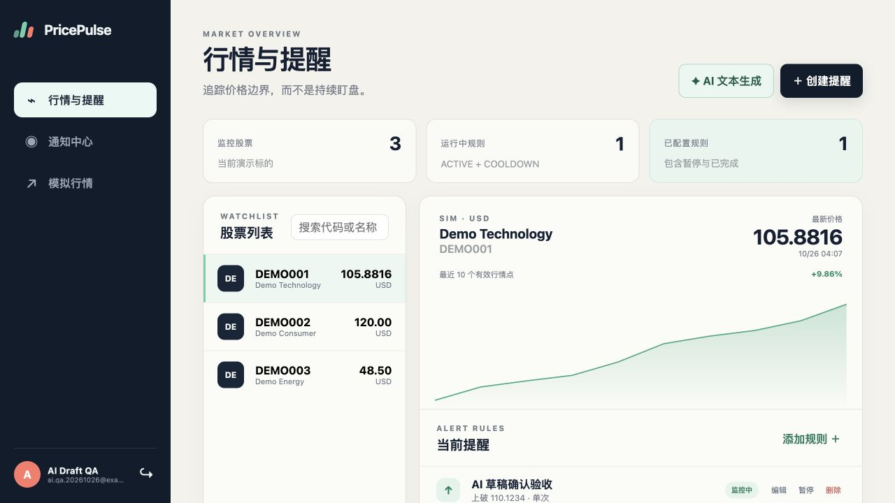
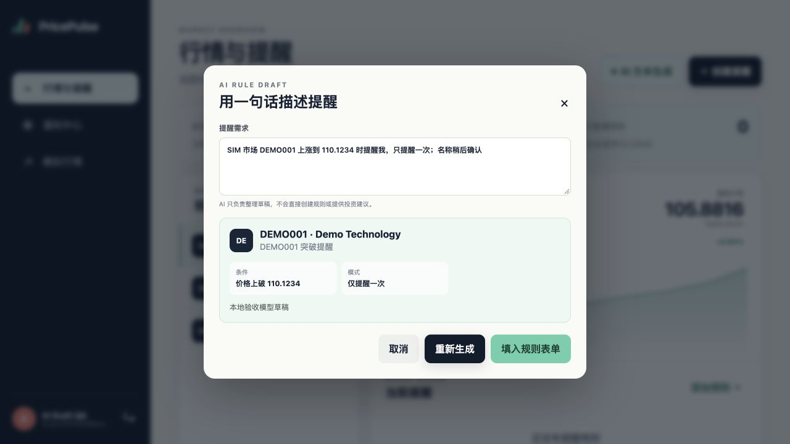
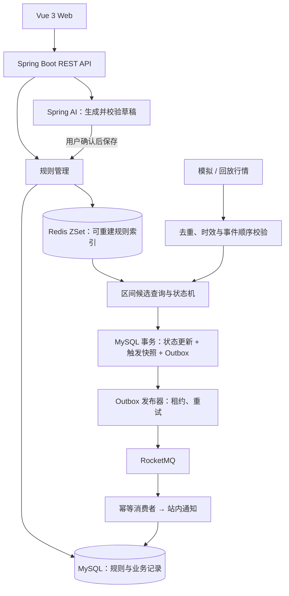

# PricePulse

> 股票异动监控与智能提醒平台

为股票设置价格上破、下破提醒，在行情穿越阈值时生成站内通知。支持自然语言生成规则草稿、重复提醒、模拟行情与历史回放。

**Java 21 · Spring Boot · MyBatis · MySQL · Redis · RocketMQ · Spring AI · Vue 3**

## 界面预览



<details>
<summary>自然语言提醒草稿</summary>



用户描述需求后，系统提取股票、方向、价格和提醒方式；用户复核或修改草稿后保存。截图使用模拟行情、合成测试账户和本地模拟模型响应。

</details>

## 功能

| 功能 | 说明 |
| --- | --- |
| 行情看板 | 查询演示股票、最新价格与近期价格走势 |
| 价格提醒 | 创建上破、下破规则，支持编辑、暂停、启用与删除 |
| 重复提醒 | 通过重新激活价控制下一轮提醒，减少阈值附近震荡造成的重复通知 |
| 通知与历史 | 查看触发价格、规则快照、事件时间，筛选通知并标记已读；API 提供规则触发历史查询 |
| 自然语言草稿 | 将一句话转换为规则草稿，缺少信息时返回澄清问题 |
| 行情模拟 | 配置上涨、下跌、震荡与正常波动；支持历史回放及异常行情测试 |
| 用户账户 | 邮箱注册、登录、JWT 认证及用户数据隔离 |

例如创建“上破 100，回到 95 后可再次提醒”的规则：

```text
94 → 100       触发提醒，进入冷却
100 → 99 → 101 不重复提醒
101 → 95       重新激活
95 → 100       再次触发
```

## 架构

采用模块化单体：业务模块运行在同一个 Spring Boot 应用中，MySQL 保存业务事实，Redis 加速候选规则查询，RocketMQ 承接异步通知。



## 核心设计

### 1. 按价格区间匹配规则

每只股票使用 Redis ZSet 组织规则阈值，通过四个分值区间区分上破、下破和双向重新激活。价格从 95 上涨到 101 时，只查询阈值位于 `(95, 101]` 的上破候选。

Redis 返回候选 ID，MySQL 再次校验实际状态。规则变更增量同步索引；数据库与缓存通过 UUID 版本校验，索引缺失或不一致时从 MySQL 重建。

### 2. 用状态机与事务约束触发

一次性提醒触发后结束；重复提醒触发后冷却，到达重新激活价后恢复监控。行情处理与规则管理共用股票行锁确定执行顺序，规则修改携带版本号，防止并发覆盖。

行情结果、规则状态、触发快照和 Outbox 在同一个 MySQL 事务中提交。全局事件键和业务唯一约束处理重复行情、并发重试与重复触发；过期、未来和乱序行情有明确的丢弃策略。

### 3. 通过 Outbox 与 MQ 可靠生成通知

触发时先持久化 Outbox，再异步发布到 RocketMQ。发布器使用 `FOR UPDATE SKIP LOCKED` 和租约领取任务，发送失败退避重试，过期租约可重新领取。

消费者按触发时的快照生成通知，`notifications.trigger_id` 唯一约束吸收重复投递。采用至少一次传递与业务幂等，消息重发不会生成第二条业务通知。

### 4. 将自然语言转换为可确认的草稿

Spring AI 通过 OpenAI 兼容接口调用模型，用 JSON Schema 约束输出。服务端解析金额、查询真实股票并校验业务条件；信息不完整时要求补充。

草稿经用户确认后进入普通规则表单，最终由原有规则接口保存。模型不直接写入业务数据；调用失败时仍可使用手动表单。

## 技术栈

| 部分 | 技术与职责 |
| --- | --- |
| 后端接口 | Java 21、Spring Boot 3.5、Spring MVC、Jakarta Validation |
| 认证与隔离 | Spring Security、BCrypt、JWT |
| 业务持久化 | MySQL 8.4、MyBatis、Flyway |
| 规则索引 | Redis ZSet、Lua、可重建索引 |
| 异步通知 | RocketMQ 5.3、Outbox、发布重试、消费幂等 |
| AI 草稿 | Spring AI、OpenAI 兼容接口、JSON Schema |
| 前端 | Vue 3、TypeScript、Vite、Pinia、Vue Router、原生 SVG 走势图 |
| 验证与观测 | JUnit、Testcontainers、JDK HTTP Client、Actuator、Micrometer |
| 本地环境 | Docker Compose、Maven Wrapper |

## 性能与可靠性验证

以下结果来自本机单实例实验，配置与原始样本均已保留。

| 实验 | 结果 |
| --- | --- |
| 单股 5 万条规则，稀疏价格穿越 | ZSet 候选查询 P95 **2.066 ms**；全量读取 + Java 筛选基线 **259.928 ms**，候选集合一致 |
| 500 条提醒集中触发 | 恢复消费后约 **1.69 秒**清空积压，缺失通知 0 |
| 额外重投 10 条 MQ 消息 | 新增重复业务通知 0 |
| 发送失败、发布确认窗口、Redis 重启 | 故障后的任务恢复与业务对账通过 |

候选查询计时不包含锁等待和触发持久化；通知消化时间从恢复消费后计算。结果代表该次负载下的观测值，不代表系统最大容量。5 万规则的冷重建约需 0.36–0.41 秒，这项成本同样记录在报告中。

[完整实验报告](docs/performance/2026-10-27.md) · [原始延迟样本](docs/performance/2026-10-27-full.json) · [实验设计与复现](docs/phase-7.md)

## 快速开始

环境：**JDK 21+、Node.js 22.12+、npm、Docker Compose**。Maven 使用仓库自带的 Wrapper。

### 1. 启动中间件与后端

```bash
git clone https://github.com/originalEzra/PricePulse.git
cd PricePulse

docker compose up -d
./mvnw spring-boot:run -Dspring-boot.run.profiles=local
```

`local` 配置连接本地中间件，Flyway 自动创建表结构并导入演示股票。后端地址为 <http://127.0.0.1:18080>，健康检查为 <http://127.0.0.1:18080/actuator/health>。

### 2. 启动前端

在项目根目录另开一个终端：

```bash
cd frontend
npm ci
npm run dev
```

访问 **<http://127.0.0.1:5173>**，注册账户后即可使用。开发环境通过 Vite 将 `/api` 代理到后端。

### 3. 体验一次完整提醒

1. 在行情页选择 `DEMO001`，创建“上破 100”的一次性提醒。
2. 进入模拟行情页，从 95 开始生成上涨行情，使价格穿越 100。
3. 在通知中心查看触发价格与提醒内容。

<details>
<summary>默认端口与其他运行命令</summary>

| 服务 | 本机端口 |
| --- | --- |
| Web / 后端 | 5173 / 18080 |
| MySQL / Redis | 13306 / 16379 |
| RocketMQ NameServer | 19876 |
| RocketMQ Broker | 10911 / 10909 |

前端检查与构建：

```bash
cd frontend
npm run type-check
npm run build
```

仅验证应用启动、不连接中间件时，可在项目根目录运行 `./mvnw spring-boot:run`。默认 `standalone` 配置不提供完整业务功能；体验 Web 页面应使用 `local`。

停止中间件并保留数据：

```bash
docker compose down
```

</details>

## 可选：启用 AI 草稿

AI 默认关闭，手动管理提醒不依赖模型服务。启用时，在后端启动终端设置环境变量。以下使用 Groq 的 OpenAI 兼容接口作为配置示例：

```bash
export PRICEPULSE_AI_ENABLED=true
export PRICEPULSE_AI_API_KEY="your-provider-api-key"
export PRICEPULSE_AI_BASE_URL="https://api.groq.com/openai"
export PRICEPULSE_AI_MODEL="openai/gpt-oss-20b"

./mvnw spring-boot:run -Dspring-boot.run.profiles=local
```

将占位值替换为自己的 Key，仅在后端环境中配置，不提交到仓库。所选模型需要支持 JSON Schema 结构化输出。

接口连通性已有真实供应商验证；完整草稿流程已通过本地模拟模型的端到端测试，真实模型对具体需求的解析效果仍需另行实测。[AI 草稿设计](docs/phase-6b.md)

## 测试与复现

在项目根目录执行：

| 命令 | 验证内容 |
| --- | --- |
| `./mvnw test` | 独立启动、API 契约、草稿校验与模型异常处理，无需中间件 |
| `./mvnw -Pintegration verify` | 临时 MySQL / Redis 上的迁移、认证、权限隔离、行情与状态一致性 |
| `./mvnw -Pmq-pipeline-it verify` | 真实 Broker 上的 Outbox → 消费者 → 站内通知链路，需先启动 Compose |
| `bash scripts/run-performance.sh` | 规则规模对比、HTTP 负载、通知积压与故障恢复 |
| `./mvnw -Pai-live verify` | 使用已配置的 Key 验证真实模型结构化输出 |

性能脚本为 MySQL 和 Redis 创建临时环境，使用独立 MQ 主题与消费组。随机种子、运行参数和每次延迟采样保存在 `target/performance/`。

## 目录与文档

```text
PricePulse/
├── frontend/          Vue 3 Web
├── src/main/java/     按业务职责划分的后端模块
├── src/main/resources/
│   └── db/            Flyway 迁移与本地演示数据
├── src/test/java/     单元、集成与性能实验
├── compose.yaml       本地中间件
├── deploy/            中间件配置
├── scripts/           实验入口
└── docs/              设计说明与实验报告
```

| 文档 | 内容 |
| --- | --- |
| [数据模型与接口约定](docs/phase-1.md) | 核心表、事务边界、统一响应 |
| [认证与规则管理](docs/phase-2.md) | 用户隔离、规则生命周期、乐观锁 |
| [行情处理](docs/phase-3.md) | 去重、事件顺序、异常策略与确定性模拟 |
| [规则索引与状态机](docs/phase-4.md) | ZSet 分区、穿越边界、增量同步与重建 |
| [可靠异步通知](docs/phase-5.md) | 发布租约、重试、消费幂等与触发快照 |
| [AI 草稿](docs/phase-6b.md) | 结构化输出、澄清、校验与用户确认 |
| [性能与故障实验](docs/phase-7.md) | 运行方法、计时口径、指标与保留问题 |

## 当前边界

- 行情来自模拟与历史回放，未接入真实行情供应商，不涉及交易与资金管理。
- 通知渠道为站内通知；尚未提供 DLQ 管理页和人工重放接口。
- 会话采用单 access JWT，前端保存在 `localStorage`；退出时客户端清除 Token，服务端不即时撤销。
- 已验证单机实验场景，未验证集群容错、长期容量和断电级持久化。
