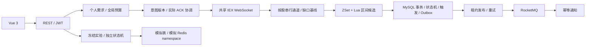

# PricePulse V2.1

> 美股实时价格提醒与隔离模拟实验平台，面向 Java 后端工程实践。

接收 Alpaca IEX WebSocket 合格成交，使用 Redis ZSet＋Lua 查询穿越区间的候选规则，在 MySQL 事务内提交规则状态、触发快照和 Outbox，经 RocketMQ 幂等生成站内通知。支持多用户共享股票监控、资产搜索及模拟开盘跳空，不提供交易下单功能。

**Java 21 · Spring Boot 3.5 · MyBatis · MySQL 8.4 · Redis 7 · RocketMQ 5.3 · Spring AI · Vue 3 / TypeScript**

V2.1 功能开发与隔离回归已完成，本机已受控升级至 **V10**，原十五股获得实际确认、正式写入开启；仓库相关开关默认关闭。供应商关闭握手、自然开盘跳空和超出现有预算的动态增删仍有验收边界，以 [最终交付记录](docs/v2.1-final-delivery.md) 为准。

## 核心能力

| 能力 | 行为与边界 |
| --- | --- |
| 搜索与个人监控 | 后端缓存 Alpaca 美股／ETF 目录，按代码或名称搜索；添加即请求监控，无规则也需要行情；个人需求持久化并隔离 |
| 共享动态订阅 | 一条上游连接，同股去重占名额；PENDING／CONFIRMED／FAILED、意图版本、实际 ACK、重连与最后需求退订协调 |
| 价格提醒 | ABOVE／BELOW、ONCE／REPEAT、冷却及重新激活；取消监控需确认，同事务软删除本人相关规则，保留历史通知 |
| 正式行情 | 纳秒身份、去重、时效／顺序／成交条件校验、按股串行通道、缺口与恢复基线；IEX 为单交易所，不等于全市场完整成交 |
| 可靠通知 | MySQL Outbox、租约领取、失败退避、RocketMQ 至少一次投递、消费唯一约束；保留触发时规则快照 |
| 图表 | 1H／1D 真实时间比例，1W／1M 压缩日历确认的休市并标断轴；纽约时间、固定信息面板、多阈值和独立历史事件 |
| 隔离模拟 | 冻结历史／规则／日历／seed，60 交易分钟批次、播放／暂停、保存恢复、版本与请求幂等；仅保留最近一次明确创建的实验 |
| 模拟开盘跳空 | 真实收盘或自定义 SIMULATION 参考，下一有效开盘仅生成一个离散点；不写正式 Outbox／通知 |
| AI 草稿与账户 | Spring AI＋JSON Schema＋服务端校验，用户确认后保存普通规则；Spring Security、BCrypt、JWT 及本人资源校验 |

当前安全预算 **15 个全局去重代码**。本机三个旧账户迁移后共 45 条个人默认需求，上游仍只有十五股。仅取消本人或删除提醒规则不会释放其他用户仍需的订阅；最后需求取消并获实际退订 ACK 后才释放。更高账户额度尚未验证，第十六股不被误标为监控中。

## 架构与源码

模块化单体，MySQL 为业务事实源，Redis 为可重建候选索引：



Redis 只返回候选，MySQL 再次校验状态。规则修改与行情处理通过股票行锁排序；缓存更新失败以数据库 token 触发重建。Outbox 与业务同事务，消息采用至少一次＋业务幂等，不宣称跨 MySQL／Redis／MQ 的全局 exactly-once。

重复提醒示例：上破 100、重新激活价 95，`94→100` 触发冷却，`100→99→101` 不重复，`101→95` 重新激活，下一次 `95→100` 再触发。

正常连续跨日仅在参考收盘可信、接收代次连续且规则开盘前生效时允许正式跳空触发，保存实际价格和参考上下文；断线／重启／缺口首笔只建基线，不补发历史穿越。历史查询不重放规则，不补造缺失分钟。

[最终架构与源码入口](docs/v2.1-final-architecture.md) · [Java 后端简历与面试总结](docs/v2.1-career-summary.md)

## 本地启动

环境：JDK 21+、Node.js 22.12+、npm、Docker Compose。编译目标 Java 21，本机基准实际使用 Java 25。

```bash
git clone https://github.com/originalEzra/PricePulse.git
cd PricePulse
docker compose up -d
# 仅在没有私人 local 配置的新环境复制，勿覆盖已有配置。
cp docs/examples/application-local.example.yml src/main/resources/application-local.yml
export JWT_SECRET="$(openssl rand -hex 32)"
./mvnw spring-boot:run -Dspring-boot.run.profiles=local
```

模板使用 Compose 公开的本地开发数据库默认账号／密码；若自定义 `DB_PASSWORD`，同步设置 `SPRING_DATASOURCE_PASSWORD`。JWT 至少 32 字节，保存在自己的环境。私人 `application-local.yml`、`.local/`、`.run/`、`.env.local` 均忽略 Git。

新库应用 V1–V10 和本地演示数据。已有库必须先备份、核对迁移并停止旧接入，不能并开同账户实例。默认 `standalone` 仅用于独立启动检查，完整业务使用 `local`。后端默认 18080；本机既有实例为 18081。

另开终端启动前端：

```bash
cd frontend
npm ci
npm run dev
```

访问 <http://127.0.0.1:5173>。若后端为 18081，在私人 `frontend/.env.local` 设置 `PRICEPULSE_BACKEND_URL=http://127.0.0.1:18081`。Vite 代理 `/api`，前后端进程均须保持运行，Compose 只管理中间件。

没有供应商数据时明确显示无数据；真实起点与模拟时钟依赖缓存的历史／交易日历，不自动生成替代价格。IDEA Application 主类为 `com.ezra.pricepulse.PricePulseApplication`、模块 `price-pulse`、工作目录为仓库根目录，参数 `--spring.profiles.active=local --server.port=18081`。最终本机的实际启动方式和 PID 见交付记录，不能假定旧工具窗口仍管理当前进程。

### 启用真实接入

仅在后端私人环境或 `.local/alpaca.env` 配置，模板按 properties 格式导入后者：

```dotenv
APCA_API_KEY_ID=<your-key-id>
APCA_API_SECRET_KEY=<your-secret>
APCA_API_ENV=paper
PRICEPULSE_ALPACA_ENABLED=true
PRICEPULSE_ALPACA_BUSINESS_WRITES_ENABLED=true
PRICEPULSE_MONITORING_ENABLED=true
PRICEPULSE_DYNAMIC_SUBSCRIPTIONS_ENABLED=true
PRICEPULSE_ADOPT_LEGACY_HOLDS=true
PRICEPULSE_MESSAGING_ENABLED=true
```

这些开关会启用真实订阅、规则处理与通知，须在 V10、预算和原规则已核对后使用，Key 不放前端。兼容持有仅在当前连接实际确认且不存在孤立有效规则时接管；不要用第二条 IEX 验证额度。

AI 可选且默认关闭，通过 `PRICEPULSE_AI_ENABLED`、`PRICEPULSE_AI_API_KEY`、`PRICEPULSE_AI_BASE_URL`、`PRICEPULSE_AI_MODEL` 配置支持结构化输出的兼容供应商。模型仅产出草稿，手动规则不依赖模型；未评估自然语言准确率。

## 性能与测试口径

以下为 **2026-10-29 V2-P5 隔离单机基准**，不是 V2.1 实盘吞吐或最大容量承诺。环境 aarch64、Java 25、10 个可见处理器、最大堆约 4 GiB；MySQL 8.4.7、Redis 7.4.6、RocketMQ 5.3.2。

| 场景 | 口径与结果 |
| --- | --- |
| 单股 1 万规则，稀疏候选 | 100 对照样本；ZSet＋Lua P95 **1.611 ms**、P99 **1.951 ms**；Redis 全量读取＋Java 扫描 P95 **47.807 ms**；集合差异 0 |
| 100 个交易小时，0 规则 | 6000 点、100 批；每批 60 点 P95 **53.400 ms**、P99 **60.597 ms**，十页完整读回 |
| 同点触发 1000 条模拟规则 | 25 样本；批次 P95 **1.684 s**，替换清理 P95 **0.800 s** |
| 250 条积压通知 | 人工暂停消费者后恢复，约 **1.078 s** 消化、缺失 0；额外重投十条，重复业务通知 0 |

候选计时不含锁等待和触发写入。通知端到端 P95 **2.763 s** 包含人为暂停，积压清空耗时不是通知 SLA；25 样本 P99 等于最大值。未测长期／最大容量、集群容错、断电耐久性或浏览器 FPS，详见 [P5 口径](docs/v2-phase-5.md)。

V2.1 阶段 4：**134 单元、115 个不同集成、65 前端／离线探针全部通过，零跳过**；前端 50、探针 15。TypeScript、Vite 与 JAR 构建通过，覆盖订阅、取消、实际临时 Broker 故障、消费幂等、模拟跳空、长实验和进程恢复。实际正式 V8 快照的隔离恢复与 V9／V10 兼容校验亦通过。

```bash
./mvnw test
./mvnw -Pintegration -Dpricepulse.p5.capacity=true verify
node --experimental-strip-types --test frontend/tests/*.test.ts scripts/tests/*.test.mjs
npm run build --prefix frontend
```

`-Pintegration` 使用临时 MySQL／Redis；MQ、进程恢复等专项另计，复现见 [阶段 4](docs/v2.1-stage-4.md)。Broker 故障只用独立 `deploy/p5/compose.yaml`，不能停止正式 Broker。普通软件测试不代替供应商或 AI 在线验收。

## 封版与文档

- [最终交付记录](docs/v2.1-final-delivery.md)：加载、开盘观察、提交及外部待验项。
- [最终架构](docs/v2.1-final-architecture.md)、[求职项目总结](docs/v2.1-career-summary.md)：设计、源码、简历和面试。
- [统一监控方案](docs/v2.1-monitoring-plan.md)、[阶段 1](docs/v2.1-stage-1.md)、[阶段 2](docs/v2.1-stage-2.md)、[阶段 3](docs/v2.1-stage-3.md)、[阶段 4](docs/v2.1-stage-4.md)。
- [加载／回滚计划](docs/v2.1-rollout-plan.md)、[只读预检](docs/v2.1-preload-readonly.md)、[API 契约](docs/v2-api-contracts.md)。
- [正式开盘跳空策略](docs/v2-opening-gap-policy.md)、[连接遗留诊断](docs/v2-stream-diagnostics-20261030.md)。

V2.1 不再增加功能。IEX 主动关闭 1006、连续跨日自然开盘跳空、实际更高订阅额度及第十六股动态增删继续按事实保留待验；没有自然发生的场景不标 PASS。私人配置、备份、原始日志、报告及构建产物仅留本机，不上传 GitHub。
