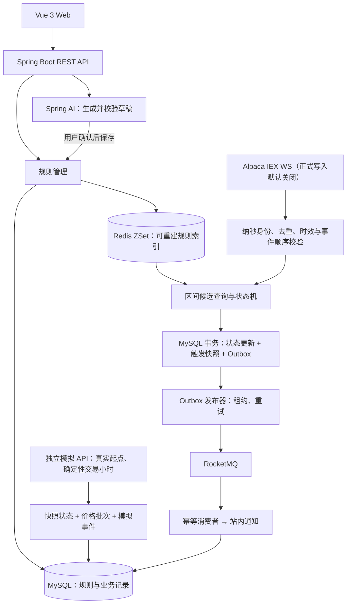

# PricePulse

> 股票异动监控与智能提醒平台

为股票设置价格上破、下破提醒，在行情穿越阈值时生成站内通知。支持自然语言生成规则草稿与重复提醒；V2 正在加入独立模拟与真实行情能力。

**Java 21 · Spring Boot · MyBatis · MySQL · Redis · RocketMQ · Spring AI · Vue 3**

V2 的 P1 隔离基础、P3 独立模拟、P4 播放体验及 P5 软件验收已完成。**P2 仍为 PARTIAL；本机十五股正式写入与真实通知闭环已通过，预置 30 条一次性验收规则；仓库默认写入仍关闭。**新开盘跳空策略已获确认迁移至 V8 并启用，后续真实连续跨日仍待观察。心跳暂停防护和有界关闭已加载，IEX 主动关闭复验仍为 1006。旧共享模拟／回放入口保持关闭。[最新连接复验与运行](docs/v2-stream-diagnostics-20261030.md) · [开盘跳空策略](docs/v2-opening-gap-policy.md) · [V2 设计](docs/v2-product-and-technical-plan.md) · [P5 验收与性能边界](docs/v2-phase-5.md)

本机开发库已备份并升级至 V8，原 IDEA 后端维持一条 IEX 订阅。后端按接受的实时成交匹配规则；图表读取分钟缓存与已接受成交尾段，页面可见时约每十秒刷新。没有有效已接受成交水位时，模拟的“最新成交”起点仍不可用。[本机当前运行说明](docs/v2-opening-gap-policy.md)。

## 界面预览


<details>
<summary>自然语言提醒草稿</summary>


用户描述需求后，系统提取股票、方向、价格和提醒方式；用户复核或修改草稿后保存。截图使用模拟行情、合成测试账户和本地模拟模型响应。

</details>

## 功能

| 功能 | 说明 |
| --- | --- |
| 行情看板 | 15 只美股；1H／1D 保留真实时间比例，1W／1M 压缩休市并标记断轴；全量缓存分钟点、纽约时间准星、当前阈值及独立分页的真实触发 |
| 价格提醒 | 创建上破、下破规则，支持编辑、暂停、启用与删除 |
| 重复提醒 | 通过重新激活价控制下一轮提醒，减少阈值附近震荡造成的重复通知 |
| 通知与历史 | 未读角标、右上角新提醒、自动更新，支持筛选与单条／全部已读；保留触发快照及历史查询 |
| 自然语言草稿 | 将一句话转换为规则草稿，缺少信息时返回澄清问题 |
| 模拟行情 | 真实历史起点＋本人规则快照；串行自动播放或手动推进 60 个交易分钟，暂停及刷新／重启恢复；仅保留最近实验，不产生正式通知 |
| 用户账户 | 邮箱注册、登录、JWT 认证及用户数据隔离 |

例如创建“上破 100，回到 95 后可再次提醒”的规则：

```text
94 → 100       触发提醒，进入冷却
100 → 99 → 101 不重复提醒
101 → 95       重新激活
95 → 100       再次触发
```

## 架构

采用模块化单体：业务模块运行在同一个 Spring Boot 应用中，MySQL 保存业务事实，Redis 加速候选规则查询，RocketMQ 承接异步通知。



## 核心设计

### 1. 按价格区间匹配规则

每只股票使用 Redis ZSet 组织规则阈值，通过四个分值区间区分上破、下破和双向重新激活。价格从 95 上涨到 101 时，只查询阈值位于 `(95, 101]` 的上破候选。

Redis 返回候选 ID，MySQL 再次校验实际状态。规则变更增量同步索引；数据库与缓存通过 UUID 版本校验，索引缺失或不一致时从 MySQL 重建。

### 2. 用状态机与事务约束触发

一次性提醒触发后结束；重复提醒触发后冷却，到达重新激活价后恢复监控。行情处理与规则管理共用股票行锁确定执行顺序，规则修改携带版本号，防止并发覆盖。

行情结果、规则状态、触发快照和 Outbox 在同一个 MySQL 事务中提交。全局事件键和业务唯一约束处理重复行情、并发重试与重复触发；过期、未来和乱序行情有明确的丢弃策略。

### 3. 通过 Outbox 与 MQ 可靠生成通知

触发时先持久化 Outbox，再异步发布到 RocketMQ。发布器使用 `FOR UPDATE SKIP LOCKED` 和租约领取任务，发送失败退避重试，过期租约可重新领取。

消费者按触发时的快照生成通知，`notifications.trigger_id` 唯一约束吸收重复投递。采用至少一次传递与业务幂等，消息重发不会生成第二条业务通知。

### 4. 将自然语言转换为可确认的草稿

Spring AI 通过 OpenAI 兼容接口调用模型，用 JSON Schema 约束输出。服务端解析金额、查询真实股票并校验业务条件；信息不完整时要求补充。

支持完整代码、名称及文字片段，例如用 `001` 匹配 `DEMO001`。唯一匹配后展示真实股票；匹配到多只股票时列出候选并要求补充。

草稿经用户确认后进入普通规则表单，最终由原有规则接口保存。模型不直接写入业务数据；调用失败时仍可使用手动表单。

## 技术栈

| 部分 | 技术与职责 |
| --- | --- |
| 后端接口 | Java 21、Spring Boot 3.5、Spring MVC、Jakarta Validation |
| 认证与隔离 | Spring Security、BCrypt、JWT |
| 业务持久化 | MySQL 8.4、MyBatis、Flyway |
| 规则索引 | Redis ZSet、Lua、可重建索引 |
| 异步通知 | RocketMQ 5.3、Outbox、发布重试、消费幂等 |
| AI 草稿 | Spring AI、OpenAI 兼容接口、JSON Schema |
| 前端 | Vue 3、TypeScript、Vite、Pinia、Vue Router、原生 SVG 走势图 |
| 验证与观测 | JUnit、Testcontainers、JDK HTTP Client、Actuator、Micrometer |
| 本地环境 | Docker Compose、Maven Wrapper |

## 性能与可靠性验证

以下为 2026-10-29 的 V2-P5 本机单实例实测，配置、原始样本及计时口径均已保留。

| 实验 | 结果 |
| --- | --- |
| 单股 1 万条规则，稀疏候选查询 | Redis P95 **1.611 ms**、P99 **1.951 ms**；全量读取＋扫描 P95 **47.807 ms**，集合差异 0 |
| 100 个交易小时、6000 个模拟点 | 60 点批次 P95 **53.400 ms**、P99 **60.597 ms**，完整 10 页读回 |
| 模拟同点触发 1000 条规则 | 批次 P95 **1.684 秒**；替换清理 P95 **0.800 秒**，每项 25 个样本 |
| 250 条提醒集中触发 | 恢复消费后约 **1.078 秒**清空积压，缺失通知 0 |
| 额外重投 10 条 MQ 消息 | 新增重复业务通知 0 |
| 实际临时 Broker／Redis 停启、发送失败、发布确认窗口 | 持久化失败、恢复及业务幂等通过；正式开发数据不变 |

候选查询不含锁等待和触发持久化；通知消化时间从恢复消费后计算，250 条样本的端到端 P95 为 2.763 秒且包含人为暂停。结果只代表本轮负载，不代表最大／持续容量；25 样本的 P99 等于其最大值。

[V2-P5 结果与复现](docs/v2-phase-5.md) · [历史 V1 实验](docs/performance/2026-10-27.md)

## 快速开始

环境：**JDK 21+、Node.js 22.12+、npm、Docker Compose**。Maven 使用仓库自带的 Wrapper。

### 1. 启动中间件与后端

```bash
git clone https://github.com/originalEzra/PricePulse.git
cd PricePulse

docker compose up -d
./mvnw spring-boot:run -Dspring-boot.run.profiles=local
```

`local` 配置连接本地中间件，干净库由 Flyway 应用 V1–V8；已有库先备份，再自动追加缺少的迁移，无需重建。V8 新增规则生效时间与开盘触发上下文，保留旧状态和历史。后端默认地址为 <http://127.0.0.1:18080>，本机 IDEA 实例使用 18081。正式行情开关默认 false，可由后端 `PRICEPULSE_ALPACA_BUSINESS_WRITES_ENABLED` 显式启用；本机已按用户确认启用，实际状态以健康 API 和页面提示为准。

### 2. 启动前端

在项目根目录另开一个终端：

```bash
cd frontend
npm ci
npm run dev
```

访问 **<http://127.0.0.1:5173>**，注册账户后即可使用。开发环境通过 Vite 将 `/api` 代理到后端。

手动启动时，前后端的两个终端都需要保持运行。Docker Compose 只运行中间件，前后端退出后需要重新启动。

<details>
<summary>使用 IntelliJ IDEA 启动</summary>

1. 用 IDEA 打开本项目根目录（包含 `pom.xml` 的 `price-pulse` 文件夹），等待 Maven 导入完成，并为项目选择 JDK 21 或更高版本。
2. 启动 Docker Desktop，然后在项目根目录执行 `docker compose up -d`。
3. 在 IDEA 顶部选择本机的 **PricePulse Local** 配置，点击 Run。该配置使用 `local` 环境与 **18081** 端口；私人运行配置不提交 Git。
4. 在 `frontend/.env.local` 中设置 `PRICEPULSE_BACKEND_URL=http://127.0.0.1:18081`。
5. 在 IDEA 的 Terminal 中执行 `cd frontend`、`npm run dev`，访问 <http://127.0.0.1:5173>。首次使用前端时需先执行 `npm ci`。

如果运行配置尚未显示，可在 `Run → Edit Configurations` 中创建 **Application**，主类选择 `com.ezra.pricepulse.PricePulseApplication`，模块选择 `price-pulse`，程序参数填写：

```text
--spring.profiles.active=local --server.port=18081
```

Run 启动后端，Terminal 中的 Vite 启动前端；两者都需要保持运行。18081／5173 已有本项目实例时直接沿用，仅在需要重启时停止相应实例，不停止其他服务。

V2 首次升级前先备份开发库，再停止旧后端后 Run。工作目录必须为含 `pom.xml` 的目录。真实行情的只读连接从本机 `.local/alpaca.env` 读取，设置 `PRICEPULSE_ALPACA_ENABLED=true`；正式业务写入另有默认关闭的开关。无需在前端配置供应商 Key。详见 [P2 启动说明](docs/v2-phase-2.md)。

</details>

<details>
<summary>后端端口被其他应用占用时</summary>

例如改用 18081，在项目根目录启动后端：

```bash
./mvnw spring-boot:run -Dspring-boot.run.profiles=local -Dspring-boot.run.arguments=--server.port=18081
```

在 `frontend/.env.local` 中设置下面一行，然后重新运行 `npm run dev`：

```dotenv
PRICEPULSE_BACKEND_URL=http://127.0.0.1:18081
```

该文件仅保存本地代理配置，已由 Git 忽略。网页入口仍为 <http://127.0.0.1:5173>。

</details>

### 3. 体验一次独立模拟

1. 登录后，在“行情与提醒”为 AAPL 等已接入美股创建本人规则；也可以用 0 条规则开始。
2. 进入“模拟行情”，选择股票及一个已闭合的真实历史分钟点，再选择模式、每分钟幅度（上限 0.3%）和可选 seed。
3. 点击“开始新模拟”；已有实验时明确确认替换。真实前缀、规则配置、日历及生成参数在此时冻结。
4. 点击“下一交易小时（60 分钟）”，查看模拟曲线、触发／重新激活统计和事件详情；跨收市自动跳到下一正常交易时段。
5. 手动推进下一交易小时，或选择自动播放；慢速／标准／快速仅改变每批完成后等待的 5／2／1 秒，不改变价格路径。暂停、离页或退出后不再请求新小时，已受理批次可正常完成。
6. 刷新页面或重启后端后恢复同一实验，默认暂停；浏览其他股票不会删除它。双标签页版本冲突会停止播放并提示恢复保存结果。模式、幅度和 Seed 的修改仅用于明确新建的实验。

模拟事件只在模拟页面展示，不创建正式通知。真实行情到正式通知已通过开市自然触发验收，模拟结果仍保持独立。起点不能自行填价；“最新成交”没有有效已接受水位时不可用。详见 [P3 阶段记录](docs/v2-phase-3.md)和[开市验收记录](docs/v2-p2-live-open-20261030.md)。

<details>
<summary>默认端口与其他运行命令</summary>

| 服务 | 本机端口 |
| --- | --- |
| Web / 后端 | 5173 / 18080 |
| MySQL / Redis | 13306 / 16379 |
| RocketMQ NameServer | 19876 |
| RocketMQ Broker | 10911 / 10909 |

前端检查与构建：

```bash
cd frontend
npm run type-check
npm run build
```

仅验证应用启动、不连接中间件时，可在项目根目录运行 `./mvnw spring-boot:run`。默认 `standalone` 配置不提供完整业务功能；体验 Web 页面应使用 `local`。

停止中间件并保留数据：

```bash
docker compose down
```

</details>

## 可选：启用 AI 草稿

AI 默认关闭，手动管理提醒不依赖模型服务。启用时，在后端启动终端设置环境变量。以下使用 Groq 的 OpenAI 兼容接口作为配置示例：

```bash
export PRICEPULSE_AI_ENABLED=true
export PRICEPULSE_AI_API_KEY="your-provider-api-key"
export PRICEPULSE_AI_BASE_URL="https://api.groq.com/openai"
export PRICEPULSE_AI_MODEL="openai/gpt-oss-20b"

./mvnw spring-boot:run -Dspring-boot.run.profiles=local
```

将占位值替换为自己的 Key，仅在后端环境中配置，不提交到仓库。所选模型需要支持 JSON Schema 结构化输出。

使用 IDEA 启动时，在运行配置的环境变量中设置这些值，Key 直接填写本体；终端示例中的引号属于 shell 语法。

接口连通性、正式业务 Schema，以及完整代码、编号片段和名称片段的真实模型提取均已验证；前端确认、填入表单及保存流程已通过本地模拟模型的端到端测试。这些结果不代表已评估自然语言准确率。[AI 草稿设计与实测](docs/phase-6b.md)

## 测试与复现

在项目根目录执行：

| 命令 | 验证内容 |
| --- | --- |
| `./mvnw test` | 独立启动、API 契约、草稿校验与模型异常处理，无需中间件 |
| `./mvnw -Pintegration verify` | 临时 MySQL / Redis 上的迁移、认证、权限隔离、行情与状态一致性 |
| `./mvnw -Pmq-pipeline-it verify` | 真实 Broker 上的 Outbox → 消费者 → 站内通知链路，需先启动 Compose |
| `bash scripts/run-performance.sh` | 规则规模对比、HTTP 负载、通知积压与故障恢复 |
| `./mvnw -Pai-live verify` | 使用已配置的 Key 验证模型连通性及正式提醒草稿 Schema |
| `node --test scripts/tests/v2-market-data-probe.test.mjs` | V2-P0 只读行情探针离线测试，无需 Key 或中间件 |
| `node --experimental-strip-types --test frontend/tests/*.test.ts scripts/tests/*.test.mjs` | 前端时间轴、播放／竞态及探针离线回归 |

V2 行情账号验证使用 `node --env-file=.local/alpaca.env scripts/v2-market-data-probe.mjs`，只读且不接入现有业务链路。凭据缺失、休市无成交样本或权限不足会明确报告未通过，详见 [P0 验证记录](docs/v2-phase-0.md)。

性能脚本为 MySQL 和 Redis 创建临时环境，使用独立 MQ 主题与消费组。随机种子、运行参数和每次延迟采样保存在 `target/performance/`。

V2-P5 的实际停启故障使用 `deploy/p5/compose.yaml` 和 `pricepulse-v2-p5-` 项目命名的独立 Broker，端口为 39876／38111／38109；完整命令与清理顺序见 [P5 记录](docs/v2-phase-5.md)。不对原 `compose.yaml` 的服务做停启故障。P5 本轮 72 项后端单元、62 项隔离集成、1 项独立性能实验及 53 项前端／探针测试通过，原数据和运行服务保留。

## 目录与文档

```text
PricePulse/
├── frontend/          Vue 3 Web
├── src/main/java/     按业务职责划分的后端模块
├── src/main/resources/
│   └── db/            Flyway 迁移与本地演示数据
├── src/test/java/     单元、集成与性能实验
├── compose.yaml       本地中间件
├── deploy/            中间件配置
├── scripts/           实验入口
└── docs/              设计说明与实验报告
```

| 文档 | 内容 |
| --- | --- |
| [数据模型与接口约定](docs/phase-1.md) | 核心表、事务边界、统一响应 |
| [认证与规则管理](docs/phase-2.md) | 用户隔离、规则生命周期、乐观锁 |
| [行情处理](docs/phase-3.md) | 去重、事件顺序、异常策略与确定性模拟 |
| [规则索引与状态机](docs/phase-4.md) | ZSet 分区、穿越边界、增量同步与重建 |
| [可靠异步通知](docs/phase-5.md) | 发布租约、重试、消费幂等与触发快照 |
| [AI 草稿](docs/phase-6b.md) | 结构化输出、澄清、校验与用户确认 |
| [性能与故障实验](docs/phase-7.md) | 运行方法、计时口径、指标与保留问题 |
| [V2-P5 软件验收](docs/v2-phase-5.md) | 当前迁移、Broker／故障、长实验／大事件验收及性能原始证据入口 |

## 当前边界

- 已实现 Alpaca IEX 历史缓存和服务端 WS 接入；本机十五股正式写入、持续开市接收与自然触发到正式通知的闭环已通过。IEX 主动关闭仍为 1006，正常连续跨日开盘跳空仍待自然行情。IEX 为单一交易所，不等同全市场实时行情；不涉及交易或资金管理。[开市验收](docs/v2-p2-live-open-20261030.md) · [最新连接复验](docs/v2-stream-diagnostics-20261030.md)。
- 通知渠道为站内通知；尚未提供 DLQ 管理页和人工重放接口。
- 会话采用单 access JWT，前端保存在 `localStorage`；退出时客户端清除 Token，服务端不即时撤销。
- 已验证单机实验场景，未验证集群容错、长期容量和断电级持久化。
