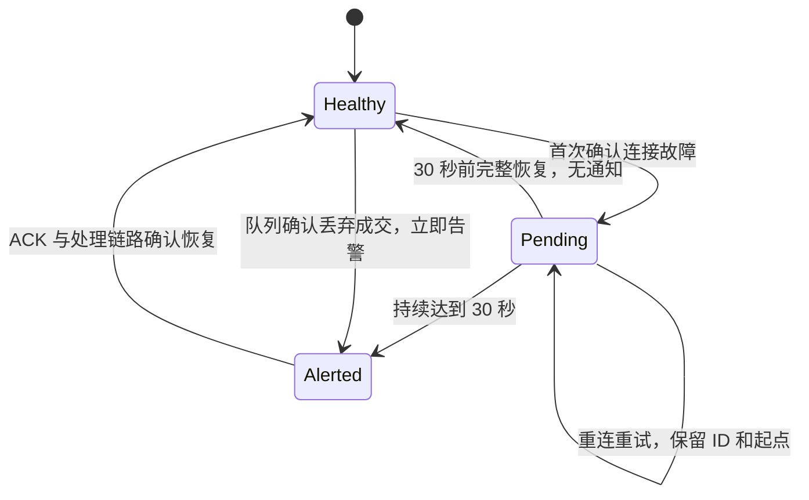

# 阶段二：监控中断、恢复与联合验收（2026-11-01）

状态：离线实现与隔离验证，**没有正式加载**。当前运行环境仍使用原后端和 V10；V11 只迁移了 Testcontainers 临时库。没有停止、重启正式后端，没有第二条 Alpaca IEX 连接，没有改正式规则、报价、通知或私人配置，没有推送或合并。

## 实现与事务边界

`AlpacaStream.fail()` 继续负责已确认的连接失败、原有代次防线、心跳检测及退避重连。`MarketFeedHealth` 在首次失败时建立 UUID 和 startedAt，后续 CONNECT_FAILED / 握手失败等沿用同一故障；诊断字段 lastFailureAt 仍表示最近一次失败，不能当作本次故障起点。计划停机的 STOP_* 诊断不创建故障。

故障恢复必须同时满足：传输健康、当前 desired intent 的全部相关股票 ACK、对应 lane 存在且没有未恢复的已知处理故障或队列缺口。检查在现有订阅控制行锁内获取持久化需求，最终 ACK 校验和关闭故障在 AlpacaStream 同一连接代次锁内执行，旧 ACK 不能确认新一代恢复。认证成功本身不足以恢复。

健康但没有成交不会开始故障；静默股票与休市不使用“30 秒无成交”判定。没有已知处理失败时，可在 ACK 和可用处理通道确认后恢复，不强制等待休市股票成交。如果已出现处理事务失败，须等待新一笔合格成交成功提交，不能仅凭网络恢复就关闭故障。



回调只采集内存事实，不在 WebSocket 或 lane 的临界区访问 MySQL / MQ。`MarketIncidentCoordinator` 每秒重试一次持久化；`MonitorIncidentService` 将故障状态、逐用户通知意图及 Outbox 放在同一 READ_COMMITTED 事务中。返回成功后才确认内存快照，数据库失败不会丢弃待持久化事实。启动前恢复已提交的未关闭故障，保留 UUID 与首次时间。

持久化的全局相关需求只要仍有一个未确认或 FAILED，恢复判断就保持保守；必须重试成功或由用户取消需求，不能把剩余故障藏在“整体已恢复”后。每个用户针对共享连接只收到一条中断通知，合并其股票列表；故障期间新受影响用户可以收到自己的第一条通知。同一用户/故障/通知类型的数据库唯一约束防止重试风暴。

## 队列溢出

原单股 1 个工作线程、ArrayBlockingQueue(1024)、清理不确定尾部和新 continuity 基线策略不变。Observer 在原 drainTo 操作完成后记录实际舍弃数量，零舍弃的竞争情况不伪造丢失事件。原因明确为 QUEUE_OVERFLOW，独立于共享连接故障，下一次持久化立即排入异常通知，无须等待 30 秒。

同一未恢复队列故障累计实际舍弃量；旧代次仍在执行的任务不能把新缺口关闭。只有新 continuity 的合格成交真实提交后才关闭该队列故障。恢复通知明确未补偿全部遗漏提醒。该笔成交的 ONCE 可独立产生 RECOVERY 价格确认；REPEAT 仍不跨缺口补造穿越。

## 通知协议与幂等

- 价格事件保持 `ALERT_TRIGGER / ALERT_TRIGGERED` 及原消息结构；没有删除或伪造 alert_triggers。
- 监控消息使用 `MONITOR_DELIVERY / MARKET_MONITORING`，payload 只携带 schemaVersion、deliveryId、userId、incidentKey，正文从数据库权威记录生成。
- 仍使用原 Outbox 发布器、租约、失败重试、正式通知 Topic 和消费者；模拟器不注入该服务或生产 Outbox。
- 消费时校验数据库中的 delivery 所有者和故障 ID；通知唯一键为 monitor_delivery_id，重复投递不重复落用户通知。
- MQ 队列可乱序。恢复消息先到时，在同一消费事务内先幂等生成已持久化的中断通知，再生成恢复通知，不依赖消息严格有序，也不把恢复冒充价格提醒。跨价格/监控两种通知不承诺 MQ 顺序。
- 通知中心沿用原列表、未读计数与已读 API；新增 eventType，监控通知的 triggerId/ruleId/stockId/triggerPrice 为 null，显示异常或恢复状态而非虚构价格。旧 V10 响应缺少 eventType 时前端仍按价格通知展示。

## V11 兼容与风险

新增 `market_monitor_incidents`、`market_monitor_deliveries` 两表。故障 UUID 是主键；active_scope 的唯一键限制同一共享连接/股票队列只有一个未关闭故障；delivery 唯一键为 (incident_key,user_id,kind)。

`notifications.trigger_id` 改为可空，保留原 FK 和唯一键；新增可空 monitor_delivery_id、FK、唯一键及 CHECK，强制每一条通知恰好来自价格触发或监控意图中的一种。V10→V11 隔离测试验证了原规则状态/版本/生效时间、报价、触发 JSON、SENT Outbox、旧通知时间与内容和已保存模拟实验保持；空来源、双来源、重复活跃故障和重复通知意图均被数据库拒绝。

本轮没有执行正式迁移。未来加载须单独批准：停服后的截止点一致性备份、恢复演练、在正式数据克隆上验证 V11，再按维护窗口迁移并启动单实例。MySQL DDL 可能持有元数据锁，也不是跨三条 DDL 的整体可回滚事务，不宣称零停机。迁移失败需先核对已完成语句，不能盲目重放或 Flyway repair。

**回滚边界：** V11 开始产生监控 Outbox 后，旧消费者无法识别 MARKET_MONITORING；不能只回退 JAR 或直接删新表。应保留兼容消费者并受控停用新生产端，或维护窗口按已验证备份一致性恢复数据库和旧代码，同时保全窗口内新增事实。不得为回退直接删除新通知、价格记录或清空 MQ。本报告不是正式加载授权或执行脚本。

## 测试与复现

| 职责 | 主要源码 |
| --- | --- |
| 故障聚合、代次与队列事实 | [MarketFeedHealth](../../src/main/java/com/ezra/pricepulse/market/MarketFeedHealth.java)、[AlpacaStream](../../src/main/java/com/ezra/pricepulse/market/AlpacaStream.java)、[MarketQuoteLane](../../src/main/java/com/ezra/pricepulse/market/MarketQuoteLane.java)、[RealMarketRuntime](../../src/main/java/com/ezra/pricepulse/market/RealMarketRuntime.java) |
| 异步持久化与恢复协调 | [MarketIncidentCoordinator](../../src/main/java/com/ezra/pricepulse/market/MarketIncidentCoordinator.java)、[MonitorIncidentService](../../src/main/java/com/ezra/pricepulse/market/MonitorIncidentService.java)、[MonitorIncidentMapper](../../src/main/java/com/ezra/pricepulse/market/MonitorIncidentMapper.java) |
| 独立消息与原发布链路复用 | [OutboxWriter](../../src/main/java/com/ezra/pricepulse/outbox/OutboxWriter.java)、[MonitoringNoticeEvent](../../src/main/java/com/ezra/pricepulse/notification/MonitoringNoticeEvent.java)、[NotificationService](../../src/main/java/com/ezra/pricepulse/notification/NotificationService.java) |
| 兼容迁移与通知页面 | [V11](../../src/main/resources/db/migration/V11__monitor_incidents.sql)、[NotificationMapper.xml](../../src/main/resources/com/ezra/pricepulse/notification/NotificationMapper.xml)、[NotificationsView](../../frontend/src/views/NotificationsView.vue) |
| 故障注入与隔离迁移证据 | [MonitorIncidentInfrastructureIT](../../src/test/java/com/ezra/pricepulse/market/MonitorIncidentInfrastructureIT.java)、[MonitorIncidentMigrationInfrastructureIT](../../src/test/java/com/ezra/pricepulse/v2/MonitorIncidentMigrationInfrastructureIT.java)、[真实临时 Broker 回归](../../src/test/java/com/ezra/pricepulse/market/OpeningGapInfrastructureIT.java) |

```bash
bash scripts/run-real-pipeline-checks.sh
cd frontend
node --experimental-strip-types --test tests/*.test.ts
npm run type-check
npm run build
```

检查脚本先冻结源码到忽略的 target 镜像，排除 application-local.yml / key / pem，使用独立 MySQL 8.4.7、Redis 7.4.6、RocketMQ 5.3.2。宿主 JDK 25.0.1 编译目标 Java 21。Alpaca 自动接入关闭；联合测试使用生产 AlpacaStream / MarketQuoteLane / QuoteIngestionService 和合成 Connector，不访问第三方。原真实本地 WebSocket loopback 测试也继续运行。

| 验收项 | 主要证据 |
| --- | --- |
| 5 秒、29 秒恢复不告警 | MonitorIncidentInfrastructureIT 参数化测试 |
| 30 秒一次、重连多次不清零、共享股票/多用户合并 | MarketFeedHealthTest、MonitorIncidentInfrastructureIT |
| 认证无 ACK、旧 intent、失效健康代次不恢复；静态接入兼容 | AlpacaDynamicStreamTest、MonitorIncidentInfrastructureIT 静态 / 动态用例 |
| 完整恢复一次、新故障新 UUID、跨重启恢复记录 | MarketFeedHealthTest、MonitorIncidentInfrastructureIT |
| 原 1024 队列实际舍弃、立即告警、新基线目标提醒 | 原生产 lane + 真实隔离 MySQL / Redis 测试 |
| Outbox SQL 故障回滚，原故障 ID 重试 | 实际 MySQL 触发器故障注入与 coordinator 重试 |
| 消息重复、并发及恢复先到；账户权限、已读计数 | MySQL 唯一键、并发消费者、原通知 API 回归 |
| 正式发布路径 | OpeningGapInfrastructureIT：临时真实 Broker 两条监控 Outbox SENT，重复重投后仍两条通知，零价格 trigger |
| 联合闭环 | 断线→30 秒告警→认证但无 ACK 不恢复→ACK→事务失败仍不恢复→新合格成交 ONCE 确认→恢复意图与通知 |
| 原功能 | 成交重复/冲突、旧水位、规则并发/状态机、Token 回滚与重建、原 Outbox、历史事件、模拟跳空和 REAL/SIM 隔离 |

最终结果：**154 项单元通过、127 项选定集成通过；另 1 项既有长容量性能实验按开关跳过**。前端 51 项测试、TypeScript 检查和 Vite 构建通过。XML 安全汇总保存于 [verification.json](verification.json)，其中公共源码树 SHA-256 已与实际测试镜像逐文件核对一致；详细日志仅保留在本机 target。既有 `pricepulse.p5.capacity=true` 的实验未计入通过，本轮不重跑或继承其性能结论。

计数口径：最后的整矩阵 154 项单元通过，128 项集成中 125 通过、1 跳过、2 项新增夹具错误；合成股票不符合原静态配置白名单。生产校验保持，隔离夹具改用 AAPL 后，在相同业务源码和镜像中将 MonitorIncidentInfrastructureIT 全部 10 项重跑通过。上述 127 是合并各套最终 XML 的不同通过用例数，不把先前失败隐去或声称最后一次整矩阵单次全绿。原失败日志与专项成功日志均保留；未选择性删除不利结果。

## 能力边界与自然市场待办

30 秒指首次**确认故障**后的持续时间，不是最后一笔股票成交之后，也不承诺第 30 秒送达。周期调度、MySQL/MQ 可用性、原发布重试策略都会影响送达。鉴权等终止性错误仍遵守原接入策略，需要核对配置，不无休止重试错误凭据。

若调度或数据库不可用跨过告警门槛，长故障可以在恢复后共同补记中断意图和恢复意图；恢复意图仍以已持久化的中断意图为前提，不把延后送达说成第 30 秒实时送达。30 秒以内恢复没有这两类通知。

整个进程退出时不能自己发通知；网络或 MySQL 完全不可用时，未提交故障事实仅在内存中，进程再次崩溃可能丢失该片段。已提交的故障与通知意图可恢复。本轮未引入外部监控、历史逐笔补偿、规则配额、微批、并行 lane 或 INSERT 优先去重。

待单独批准受控加载后，在自然市场只读核验：实际 IEX 断线的首次时间和退避、十五股 ACK 与处理健康、自然恢复首笔的确认时间/价格/上下文、正式异常及恢复通知送达时间、无重复或跨用户通知。自然不发生的故障/开盘跳空不得标为 PASS。IEX 1006 等供应商关闭遗留问题仍保留，此功能只是识别与提示，未宣称解决其成因。
