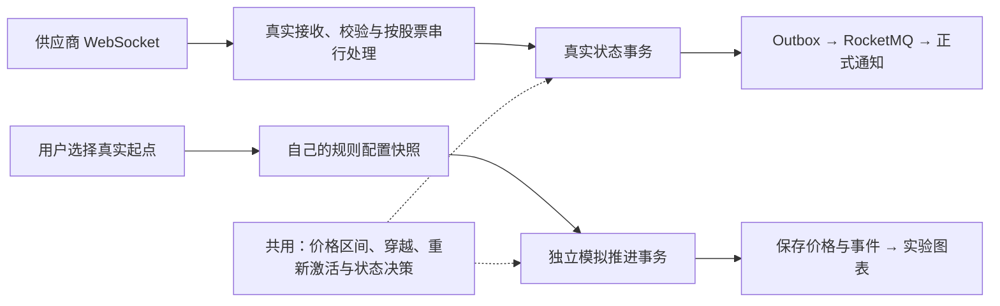

# PricePulse V2：产品方案、技术设计与分阶段计划

状态：产品方案已确认，V2-P1、P3、P4 及 P5 软件验收已完成。十五股同库正式行情写入及开市真实通知闭环已通过；仓库默认关闭。用户已确认加载新开盘跳空策略 V8，源码／隔离回归、正式迁移保留及休市订阅心跳复核通过，后续真实连续跨日仍待验，见[策略记录](v2-opening-gap-policy.md)。V2-P2 保留 IEX 主动关闭及历史心跳问题为 PARTIAL。运行证据见[开市记录](v2-p2-live-open-20261030.md)、[十五股启用记录](v2-p2-live15-rollout.md)、[P5 验收](v2-phase-5.md)及各历史阶段记录；公开用途核对不替代账户附加协议证明。

本机现为 V8，原 IDEA 后端使用单条十五股 IEX 连接；30 条一次性验收规则已通过既有 API 创建，原规则和模拟结果保留。原 60 个窗口／事件页及代理、V8 的十五股日线／旧事件上下文兼容复核均通过。后续本机验收仅观察现有运行，不并发启动第二条 IEX 连接或对日常库做压力／故障测试。

本文件以本次确认的产品方案为准。它覆盖旧版 V2 任务书及此前讨论中与之冲突的设计，不代表这些能力已经实现。最初设计轮只更新文档；实施进度、实测结果和阻塞见 [V2-P0 记录](v2-phase-0.md)。

2026-10-28 用户确认四项正式决策：

1. D1：复制规则配置后重新初始化模拟状态；未暂停规则从 ACTIVE 开始，PAUSED 不参与，DELETED 不复制。
2. D2：下一小时累计推进 60 个正常交易分钟，跨收盘跳过休市。
3. D3：默认保留起点前一个正常交易日的真实上下文；模式和幅度在开始时固定，播放速度可以调整，其他参数修改需要明确开始新实验。
4. D4：已确认数据缺口后首笔建立新匹配基线；历史只补图，不补发缺口提醒。已冷却规则可以按当前价重新激活，但不产生触发／Outbox。

每轮只实施一个阶段，运行对应验证后汇报并暂停；不能自动进入下一阶段。

后续已确认调整阶段依赖：先实施不依赖开市的 P1。P0 的正常交易时段采样保留为 P2 启用真实行情写入前的检查，数据用途许可另行核对。P1 进度见 [隔离基础实施记录](v2-phase-1.md)。

## 1. 产品范围与旧方案的差异

仍然只有三个导航模块：

| 模块 | V2 的职责 |
| --- | --- |
| 行情与提醒 | 初始五股经后续确认扩展为十五股；查看真实时间轴；管理自己的真实提醒规则；真实触发进入正式通知 |
| 通知中心 | 只展示真实行情产生的正式通知；保留未读计数、弹窗、筛选、单条／全部已读 |
| 模拟行情 | 选真实起点，冻结自己的规则配置，用独立价格和规则状态观察触发；只保存用户最近一次实验 |

明确覆盖旧方案的内容：

| 事项 | 旧任务书／前次设计方向 | 本次方案 |
| --- | --- | --- |
| 模拟规则 | 独立模拟规则或环境化规则管理 | 开始实验时复制自己的真实规则配置；没有模拟规则 CRUD 页面 |
| 模拟通知 | 模拟通知进入可筛选的通知中心 | 只在实验图表与统计中展示；不创建正式通知，不走 Outbox／MQ |
| 实验数量 | 多实验、实验历史／作用域切换 | 每个用户只有最近一次；明确开始新实验才替换旧实验 |
| 切换股票 | 旧页面会清空当前结果 | 只改变浏览对象；不能隐式删除已保存实验 |
| 历史回放 | 独立动态回放流程 | 删除产品入口；历史只读；历史点只能作为新模拟的起点 |
| 模拟时钟 | 自由推进或未限定交易日历 | 按美股正常交易时段推进，跳过休市 |
| 数据隔离模型 | 将所有数据统一扩展为通用行情流／实验作用域 | 真实链路保留，模拟独立存储；只抽取可复用的匹配内核 |
| 图表 | 统一图表但可能仅显示实验数据 | 模拟页一张图连续展示真实历史前缀和模拟后缀，明确分界 |

不增加实验历史列表、实验对比、导出、独立模拟规则管理、多渠道通知、微服务或新的消息中间件。现有 AI 草稿继续服务真实规则管理，不让 AI 决定实验归属或修改已冻结快照。

## 2. 当前仓库核对结果

评估基于本地工作区，HEAD 为 `4735ba2a2b5f89046175da0e8a78073812993d67`，包括尚未提交的图表、AI、规则观察和通知改进；不是只看远端 V1。

| 已检查的位置 | 已有能力／实际行为 | V2 处理 |
| --- | --- | --- |
| `README.md`、各阶段文档、`pom.xml`、`frontend/package.json` | Spring Boot／MyBatis 模块化单体；Vue 3、Pinia、原生 SVG | 保留框架，不引入大型图表库或通用工作流平台 |
| `V2__create_core_schema.sql`、`V3__add_rule_index_token.sql` | 7 张业务表；股票保存共享最新价和索引版本 | 保留其真实业务角色；增加模拟专用存储 |
| `QuoteIngestionService.ingest` | 按股票行加锁；模拟、回放、真实入口共享更新路径 | 将此路径限定为真实处理；模拟不得调用 |
| `MarketService.simulate / replay` | 模拟每步只增加 1 微秒；批量同步处理且写入共享最新价 | 替换为持久化实验与逐交易小时推进；移除公开回放写入口 |
| `AlertEvaluationService.evaluate` | 同股票所有候选规则参与；状态更新、触发记录、Outbox 混在一个服务中 | 提取纯状态决策；分别编排真实和模拟副作用 |
| `RuleIndex` | `pricepulse:rules:{stockId}`；四个分值区间、Lua、UUID 版本重建 | 复用算法和脚本，隔离 Key、状态加载器和版本存储 |
| `StockMapper.findActiveByIdForUpdate`、规则管理 | 行情和规则变更共用股票行锁；规则可修改所属股票 | 真实链路继续使用；模拟推进改锁自己的实验行 |
| `AlertTriggerMapper`、Outbox、通知服务 | 触发快照、租约发布、至少一次投递、消费唯一约束已存在 | 保留真实可靠性链路；补旧数据来源过滤 |
| `PriceSparkline.vue` | 已有坐标、准星、阈值、触发／重新激活标记；X 坐标仍按数组下标 | 改为时间比例、时间查找和独立事件图层 |
| `DashboardView.vue` | 最近行情点数查询、选定一条规则的触发记录 | 改为时间窗口查询与当前用户的事件覆盖层 |
| `SimulationView.vue` | 切换股票清空结果；结果只有页面内存；能创建独立规则 | 改为浏览股票与已保存实验分离；移除模拟内建规则入口 |
| `NotificationsView.vue`、通知 store | 未读角标、轮询、弹窗、旧请求保护已经具备 | 继续复用，不增加模拟通知筛选 |
| `InfrastructureIT`、`NotificationPipelineIT`、`PerformanceIT` 等 | 认证越权、边界穿越、冷却、索引重建、回滚、并发去重、Outbox、真实 Broker 链路已有覆盖 | 保留等价验证，增加隔离、日历、恢复与只读测试 |

现有报告包含成功的单元／契约测试、24 项 MySQL／Redis 集成测试，以及独立 Broker、性能实验记录。报告来自此前执行，本轮没有重跑；不能据此声称 V2 已通过测试。前端目前没有专门的组件测试工具，需要为新增纯函数、状态与请求竞态建立轻量测试覆盖。

### 必须先修复的入口问题

当前选择 `ruleId` 只控制“观察哪条规则”，不控制“实际执行哪些规则”。模拟仍可触发其他用户的同股票规则、改变真实最新价并创建 Outbox。普通登录用户还可调用 `/api/market/quotes / simulate / replay`。

因此：**先隔离写路径并收紧入口，再开启真实 WebSocket。仅修改 Redis Key、增加前端 REAL/SIMULATION 参数或通知过滤，都不足以解决问题。**

## 3. 最小架构：真实链路保留，模拟独立

### 3.1 不变式与用户隔离

| 数据／能力 | REAL | SIMULATION |
| --- | --- | --- |
| 股票元数据 | 所有用户共用同一真实股票目录 | 只引用目录，不复制股票 |
| 最新价与处理顺序 | `stocks`，每只股票唯一一份 | `simulation_runs`，每个实验独立一份 |
| 规则配置 | `alert_rules`，属于用户 | 开始时复制“当前用户＋当前股票”的配置 |
| 规则运行状态 | `alert_rules.status / version` | 模拟快照表的独立状态／版本 |
| 候选索引 | 该股所有用户的真实规则；符合正式提醒业务 | 仅该实验快照；不能加载任何实时规则作为候选 |
| 触发历史 | `alert_triggers` | 模拟专用规则事件表 |
| Outbox／MQ | 保留现有链路 | 无依赖、无写入、无投递 |
| 通知 | `notifications` | 不创建通知 |
| 访问范围 | 公共行情；规则、触发与通知仍按当前用户过滤 | 所有操作先校验实验属于当前用户且仍是最近一次 |

所有用户 ID 从 JWT 获取。不能信任请求体提供的 `userId` 或 `environment`。真实行情接入可以影响同股票所有用户的真实规则，这是预期；模拟只能影响当前用户的一份实验。

### 3.2 匹配复用的边界

从 `AlertEvaluationService` 提取小范围的 `RuleTransitionEngine`：输入规则配置、当前状态、前后价格，输出“无变化／触发／重新激活”和目标状态。它不读写数据库、Redis、Outbox 或通知。

- 真实编排继续负责原有状态更新、触发快照和 Outbox 的同事务提交。
- 模拟编排负责自己的快照状态、价格批次和事件提交。
- `RuleIndex` 将脚本／分值编码与数据加载分开，通过小接口提供 Key、版本、候选和重建数据。不引入通用事件平台，也不复制整套状态机。
- 模拟服务构造依赖中不得出现 `OutboxWriter / NotificationService`；不采用共享写路径上的 `sendNotification=false` 开关。
- 上破、下破的开闭区间及 ONCE／REPEAT 状态转换保持现有含义，使用两条路径的同一组边界用例验证。

### 3.3 行锁、Redis Key 与幂等键审查

| 位置 | 建议 |
| --- | --- |
| 真实股票行锁 | **保留**。真实行情与真实规则变更仍锁 `stocks.id`；真实最新价和 `rule_index_token` 仍存该行 |
| 模拟推进 | 只锁所属 `simulation_runs.id`；不锁、不更新真实股票／真实规则 |
| 开始／替换实验 | 先锁当前 `users.id` 串行化同一用户的替换，再锁旧实验行；按一致的 MVCC 快照读取起点和自己的规则，不对真实业务行加写锁 |
| 真实 Redis Key | 例如 `pricepulse:v2:real:rules:{stock:123}`，版本来自股票行 |
| 模拟 Redis Key | 例如 `pricepulse:v2:sim:rules:{run:UUID}`，版本来自实验行；成员是模拟快照 ID |
| 缓存重建 | REAL 只读真实规则；SIM 只读该实验快照状态。实验 Key 丢失、过期或事务回滚后可重建，不能回退到真实索引 |
| 真实行情唯一键 | 保留全局唯一约束，但事件键必须包含供应商、feed、股票、供应商事件身份及其有效唯一范围；不是只用时间或裸交易 ID |
| 真实触发唯一键 | 现有“真实规则 ID＋转换前版本”仍有效；不因增加模拟而机械重做 |
| 正式通知唯一键 | 继续按真实 `trigger_id` 去重 |
| 模拟推进唯一键 | `(run_id, batch_no)`、`(run_id, request_key)`，配合请求摘要和预期版本 |
| 模拟规则事件唯一键 | `(run_id, snapshot_rule_id, point_seq, event_type)`，允许重新激活后的新一轮触发 |

Redis 仍是可重建加速层，MySQL 是事实来源。缓存更新不与 MySQL 构成分布式事务；保留 UUID 版本不一致时重建的恢复设计。模拟按批次处理时，批内内存状态、Redis 版本和最终数据库版本必须一致；不能让第二个价格点仍使用第一个点之前的版本。批次中途回滚后，下一次必须基于数据库版本修复缓存。

## 4. 数据模型与迁移

### 4.1 现有表最小变更

| 表 | 必要变更／保留内容 |
| --- | --- |
| `users` | 不增加认证功能；用于同用户新实验替换的短事务串行化 |
| `stocks` | 保留真实最新价及索引版本；补供应商／feed、最后有效接收时间、精确事件水位和接受序号等必要实时元数据 |
| `quote_events` | 增加 `origin_type=LEGACY/REAL`、feed／供应商身份、精确事件时间、接受序号；`received_at` 改为接收边界实际采集，不使用入库时刻代替；保留丢弃原因 |
| `alert_rules` | 不增加实验字段，不复制为环境通用表；仍是用户唯一的规则管理来源 |
| `alert_triggers` | 保留真实触发与 JSON 快照；时间线按原始 `quote_event_id` 关联股票，不能用规则当前股票推断历史归属 |
| `outbox_events` | 保留字段、事务和租约重试；状态约束增加明确的 QUARANTINED。派发前校验来源，旧模拟消息进入隔离处理，不进入正式消费 |
| `notifications` | 保留表结构和 `trigger_id` 唯一约束；列表、计数、单条／全部已读和消费入口统一限定 REAL 来源 |

真实触发时间可以沿原始行情读取精确值，不要求给每张表重复增加纳秒列。所需复合索引以查询的 `EXPLAIN` 为依据，例如真实报价按 `origin_type + stock_id + event_time + id` 查询。现有外键自动建立的索引先核对，避免重复新增。

### 4.2 新增 5 张表：4 张模拟表＋1 张只读行情缓存表

这是 V2 总体模型；P1 为四张模拟表新增了 V5 迁移，真实历史缓存表留给 P2。字段按职责列出，具体实现见各阶段记录。

| 表 | 主要字段 | 关键约束与用途 |
| --- | --- | --- |
| `market_price_bars` | id、stock_id、provider、feed、resolution、adjustment、start_at、end_at、OHLC、provider_revision、fetched_at | 唯一 `(stock, provider, feed, resolution, adjustment, start_at)`；保存真实历史分钟线，补图不运行规则 |
| `simulation_runs` | UUID、user_id、stock_id、origin_snapshot、history_prefix_snapshot、模拟参数、seed、generator_version、calendar_version/snapshot、sim_clock、latest_price、next_point_seq、last_batch_no、version、rule_index_token、start_request_key/hash、时间戳 | **UNIQUE(user_id)**；只保留一个实验；起点、真实前缀、参数固定，不依赖后续行情缓存修订 |
| `simulation_rule_snapshots` | id、run_id、source_rule_id/version、不可变 config_json、source_status、initial_state、current_state、state_version、last_triggered_at | UNIQUE(run_id, source_rule_id)；来源 ID 只做追溯，不对真实规则建级联外键 |
| `simulation_steps` | id、run_id、batch_no、request_key/hash、from/to_clock、first/last_point_seq、points_json、统计摘要、created_at | 双唯一键 `(run_id,batch_no)` 与 `(run_id,request_key)`；每个小时一批、最多 60 个分钟价格点，持久化幂等返回依据 |
| `simulation_rule_events` | id、run_id、step_id、snapshot_rule_id、point_seq、event_type、event_time、price、from/to_state | 保存 TRIGGERED／REARMED 事实；价格、规则及阈值从事件和不可变快照读取；按实验＋时间／点序号分页 |

模拟规则状态和事件按行存储，避免每推进一个点都重写全部规则。每小时固定小批量价格可放 `points_json`，因此无需再加逐笔价格表或独立“推进请求表”。大量同时触发的规则事件不塞进这个 JSON；按行批量写入事件表，避免单个价格批次无限膨胀。

每个模拟点包含全局 `pointSeq`、UTC 时间和十进制价格。事件引用 `step_id + point_seq`；应用层检查点确实属于该批次。快照、批次、事件必须通过实验关联，并用复合约束或等价校验防止跨实验引用。按批次时间范围读取价格，支持分页，不要求一次载入实验的全部数据。

真实历史前缀默认保存起点前一个正常交易日的上下文（D3）。它是实验的不可变输入，不是另建历史回放数据集。

### 4.3 迁移策略与旧数据

不修改已执行的 Flyway V1–V3。后续新增迁移分别引入隔离模型、来源字段／索引、真实历史缓存；先备份并在临时库演练。

建议保留 V1 数据，**不默认删除或把它们改称真实数据**：

1. 迁移时所有已有 `quote_events` 标为 `LEGACY`；只有受信任的真实接入器能写 `REAL`。
2. 旧 DEMO 股票、规则、触发和通知原样留库。正式股票列表仅返回 V2 启用的真实标的；正式通知查询沿 `notification → trigger → quote.origin_type` 限定 REAL。
3. 单条已读、全部已读、未读计数、事件详情也执行同样来源和用户过滤，不能只在页面隐藏旧通知。
4. 暂停旧生产入口；确认旧 Outbox 待发记录和 Broker 中未消费消息的数量。旧域消息的 Outbox 置为 QUARANTINED，保存原因，不再派发；Broker 中已存在的 LEGACY 消息经来源校验后确认消费，并留下结构化日志／计数，不创建正式通知。迁移需同步更新 Outbox 状态约束，不能让旧消息无限重试。
5. 真实触发事务和消费者都校验受信任的 REAL 来源。消费幂等仍由现有唯一约束负责。切换期间先停接收与派发，部署兼容来源判断的服务，处理旧积压后再开启真实接入。
6. 旧 `LocalDateTime` 来源未必具有可靠时区，不能统一假装是 UTC；LEGACY 数据不作为真实图表或新实验起点。
7. 实验开始失败时旧实验必须保留；替换清理在同一数据库事务中完成，Redis 清理放在提交之后且按旧 runId 精确操作。旧 Key 清理失败可交给 TTL，不影响新实验。

正式通知查询多一次来源关联是为了最小改动；若实际执行计划表明它影响通知计数，再考虑给通知冗余不可变来源，不能在没有证据时先扩散字段。V1 数据后续是否清理可另行决定，不是 V2 上线前置的数据删除要求。

## 5. 规则配置快照与实验生命周期

### 5.1 开始时冻结什么

冻结当前用户该股所有未删除规则的完整配置：名称、方向、阈值、ONCE／REPEAT、重新激活价、来源 ID／版本以及起始状态决策。一次一致性读取，不能沿用当前默认 limit 截掉一部分规则。

真实规则后续编辑、暂停、删除、转移股票或触发，都不改变已开始实验。模拟也不回写真实规则。无规则时仍可生成价格，并明确提示“本次快照 0 条规则”；创建规则的入口返回真实模块。

**已确认的起始状态语义（D1）：**复制配置后重新开始一次实验，不继承真实运行进度。未暂停规则（包括真实 COOLDOWN、已完成的一次性规则）在实验中从 ACTIVE 开始；PAUSED 保持不参与；DELETED 不复制。保存来源状态及初始化策略，避免误认为实验从真实状态续跑。

起点价格只建立前价基线，不在开始瞬间凭空产生提醒；从生成的下一点开始判断穿越。起点已经处于阈值另一侧时，必须随后出现符合既有穿越定义的路径才触发。

### 5.2 只保留最近一次，且不因浏览切换删除

前端分别保存 `browseStockId` 和 `currentRun.stockId`：

- 进入页面先读取自己的最近实验；有实验就可恢复参数、快照、时钟、曲线和触发。
- 选择另一只股票只加载该股票的真实历史／起点候选；保留已保存实验，并提供返回其结果的入口。
- 只有按下“开始新模拟”且确认替换，才提交带 `expectedCurrentRunId` 的请求。
- 后端锁用户行，检查预期旧实验；同一事务中删除旧实验子数据、创建新实验。任何失败回滚，旧结果仍完整存在。
- 新实验使用新 UUID。旧实验的在途推进和延迟响应不能写进新实验；后端检查 runId，前端检查 runId 和请求版本。
- 重试相同开始请求返回同一次创建结果。若该实验已被再次替换，旧开始请求不得复活更旧的实验。

起点与真实前缀必须先由可信行情缓存提供；不能在持有用户／实验行锁时等待供应商网络请求。缺数据时返回明确错误并保持原实验。

删除最近实验的后台数据是替换的一部分，不需要新增“实验历史”或“清空历史”产品页面。级联删除的锁持有时间必须实测；若长时间自动播放导致规模过大，需要明确容量边界，而不是静默截断已展示结果。

### 5.3 下一小时、自动播放和恢复

`advance` 每次原子推进一个交易小时：

1. 校验 JWT 归属、当前 runId；锁实验行。
2. 先检查幂等请求；已提交的相同请求返回存储结果，不重复生成、不重复触发，即使其请求中的预期版本已经落后。相同 Key 不同参数返回冲突。
3. 对新请求校验预期批次与版本；依交易日历生成 60 个按交易时长递进一分钟的点，按 seed、全局 pointSeq 和 generator_version 确定价格；交易日历不足则整批失败，不提交不完整小时。
4. 用快照候选和独立状态逐点匹配，记录触发／重新激活。
5. 一个事务提交批次价格、规则状态、事件、时钟、版本和索引版本；失败则整个小时回滚。

不能每一小时重新初始化同一随机序列。采用可按全局点序号重建的确定性生成算法，或显式保存生成器状态；记录版本，保证重试、重启、分批与一次生成的同路径测试可比。

自动播放由页面单个串行循环请求下一小时，等待本次响应后才安排下一次。暂停／退出页面停止发新请求，已受理的一小时可正常完成；恢复结果时显示最后提交进度并默认暂停。不增加服务端后台自动推进器，也不声称关闭页面后仍持续模拟。

两标签页并发推进时，由版本和批次约束让过期请求返回冲突并停止该页面自动播放，提示刷新。播放速度只改变真实等待间隔；不改变模拟时刻或价格。开始后固定模式／幅度，改变这些输入需明确开始新实验（D3）。

## 6. 时间语义与真实行情边界

### 6.1 时间字段与顺序

| 名称 | 定义 |
| --- | --- |
| eventTime | 供应商成交事件发生时刻；JSON 必须带 UTC `Z` 或明确偏移，拒绝无时区时间 |
| receivedAt | 服务端接收边界捕获时刻，不是排队后数据库插入时刻 |
| processedAt／延迟指标 | 处理完成时刻，用于区分供应商延迟、队列等待和通知延迟 |
| simulatedAt／simClock | 实验时钟，与现实机器现在几点无关 |
| acceptedSequence | 同股票成功接受事件的单调序号；解决同一时刻多个合法事件的处理次序 |

Java 边界使用 `Instant`；MySQL 可读时间统一 UTC、微秒；供应商如有纳秒，另存精确整数水位（`BIGINT`）供去重／乱序判断。[MySQL 官方说明](https://dev.mysql.com/doc/refman/8.4/en/fractional-seconds.html)的日期时间字段精度上限为 6 位小数。传给浏览器的纳秒值用字符串，不能放进不安全的 JS Number。图表像素定位可用毫秒，详情保留原始精度。

不能继续使用“截成微秒后 `eventTime <= latestQuoteAt` 全部丢弃”的策略。重复按事件身份判断；时间小于已接受水位才视为迟到；同一精确时间的不同合法成交可按接收次序获得接受序号。供应商的交易 ID 不自动当成全局排序号。

过期与未来容差复用配置但按选定 feed 核验：迟到记录不倒退最新价、不回放匹配；发现数据缺口需要展示。供应商更正／撤销、成交条件以及超过现有价格精度的输入必须有明确接受或拒绝策略，不能靠四舍五入掩盖。

价格继续使用现有十进制／PriceTicks 内核与现有显示约定，不把图表计算用的浮点数用于业务比较；本次不顺带重做价格精度模型。

### 6.2 交易时段与“下一小时”

时区为 `America/New_York`，正常交易时段以交易日历返回的开闭市时刻为准，支持夏令时、节假日及提前收市；不硬编码澳洲／北京时间偏移。

**“下一小时”累计推进 60 个正常交易分钟（D2）。**例如距收市还剩 20 分钟，推进一小时会生成当天 20 分钟＋下一交易日 40 分钟。每个点代表又经过一分钟交易时长后的模拟价格；成交起点带秒／纳秒时不擅自对齐整分钟。跨收盘不足一分钟的剩余时长接到下一交易时段，累计推进量仍严格为 60 分钟。休市期间不生成点；起点在休市时保留原点，从下一开市时刻累计交易时长。

2026-10-29 用户进一步确认图表调整：1H／1D 使用真实经过时长；1W／1M 与模拟的真实前缀＋模拟后缀共用交易时间轴，仅压缩日历确认的隔夜／周末／节假日休市，并以 // 断轴标记和虚线跳空表示省略。连续交易时段内仍按实际时间比例排列，不按点序号等距。点和事件的 UTC／纳秒时间及价格保持原值，悬停准确显示纽约时间；时段内数据缺口及日历未覆盖的时段不得压缩。

历史分钟范围查询不增加隐式行数限制，也不再按墙钟时间桶丢弃已有分钟点；页面显示缓存分钟数量、范围覆盖和没有分钟线的交易区间，不能用断轴掩盖数据不足。实际成交尾段的采样仍须返回原始成交，不能制造均价点。详见 [统一时间轴调整记录](v2-time-axis.md)。

日历和生成器版本随实验保存，并保存该实验所用开闭市日程快照；仅存版本字符串而无法取回相应数据不够。超出已验证日历范围或日历不可用时拒绝该小时推进、保持旧结果，不自行猜测交易日。升级后也不能静默改用另一套随机算法；若旧生成器不再支持，保留浏览结果并提示明确开始新模拟。

### 6.3 真实图表时间窗口

以下是建议的精确定义，避免把窗口名称误当成供应商 K 线周期：

| 选择 | 查询范围 |
| --- | --- |
| 1H | 截止锚点前 60 个墙钟分钟；休市时锚点落在最近正常交易时段收盘 |
| 1D（默认） | 当前正常交易日；休市日用最近交易日。横轴可覆盖完整开闭市范围，尚未发生部分留空 |
| 1W | 截止锚点向前 7 个自然日，筛选正常交易时段内的数据 |
| 1M | 按纽约本地日历向前一个月，筛选正常交易时段内的数据 |

开市时锚点用服务端当前时刻，数据落后显示延迟；1W／1M 保留不同交易日之间的真实时间间隔。窗口内可按时间桶降低绘图密度，但触发事件不能随价格采样而丢失。空区间显示缺数据，不用均匀插值伪造行情。

### 6.4 真实供应商接入与断线取舍

优先技术验证 Alpaca，尚未承诺最终供应商。已核对[官方 Market Data FAQ](https://docs.alpaca.markets/us/docs/market-data-faq)：免费实时美股 feed 为 IEX 单一交易所；无订阅的 SIP 历史查询存在至少 15 分钟延迟约束。**本轮没有凭账号验证权限或调用真实行情 API。**

接入阶段必须实测 3–5 标的的：WebSocket 认证和订阅额度、成交／报价／分钟线区别、实时 feed、历史 1M 范围和分页、分钟线修订、交易日历权限、费用与展示／自动提醒用途许可。价格线优先统一同一 provider／feed／未复权口径；不能把 IEX 实时尾段和 SIP 历史无说明混为一条完整市场曲线。

API Key 仅通过后端环境配置提供，不进入 Git、前端构建、响应、实验快照或日志。浏览器只访问 PricePulse，不能直接携带供应商凭据订阅行情。

WS 接收器只负责接收和规范化；使用有界缓冲与按股票串行处理，连接管理负责退避重连、重新认证和重新订阅。首批只需一个接入实例，不增加分布式行情主节点选举。不能让普通用户向真实处理入口伪造价格。

必须区分连接状态和价格新鲜度：已连接不等于有新报价；休市不等于故障；IEX 稀疏成交不等于全市场没有交易。前端显示 feed、最后事件时间、休市／延迟／断线／缺口。

**已确认的缺口策略（D4）：**首次启动、停机恢复或确认存在不连续数据时，第一笔有效实时成交只建立新的匹配基线，不补造缺口期间的触发；连续实时段再沿用原有穿越判断。历史补图只补曲线，不补发提醒。代价是缺口内可能漏掉穿越，不能承诺供应商断线期间“不漏提醒”；本次不增加缺口补发机制。

2026-10-30 用户补充正常开盘语义：同一接收代次连续跨至下一实际交易时段、存在同源可信参考收盘、且当前 ACTIVE 规则在开盘前已创建并生效时，首笔合格成交可按参考收盘跨越阈值触发，标记“开盘跳空”，保存实际价／时间及冻结参考。异常恢复首笔、参考不足或不符合生效时间仍只建基线；不补发历史。评估、实现及加载状态见[开盘跳空策略](v2-opening-gap-policy.md)。

建立新基线时，已冷却规则若按这笔有效价已经满足重新激活条件，可只执行重新激活并同步索引，不生成触发／Outbox。需专门测试，避免丢掉前价后规则永久滞留冷却；ACTIVE 规则仍不在建基线时凭空触发。

真实接入压力也必须实测：当前每笔成交有股票行锁与数据库事务。超出处理能力时要显式标记缺口／过载并恢复，不能悄悄采样成交却声称提醒完整。现有 Outbox 可靠性保障的是已提交触发之后的通知，不覆盖从未收到或从未入库的外部行情。

## 7. 只读时间线与 API 契约

P0 固定的具体请求、字段和幂等语义见 [接口与时间契约](v2-api-contracts.md)。这是后续阶段目标，不能当作当前已经存在的接口。

### 7.1 真实时间线

新增 `GET /api/market/stocks/{stockId}/timeline?window=1D&anchor=...`，沿用现有 ApiResponse 包装，省略参数使用默认窗口。

响应至少包含：

- `scope: REAL`、股票、provider／feed、USD、市场时区。
- `range: from/to/asOf`、分辨率、数据覆盖范围／缺口、市场与连接健康状态。
- `points[]`：稳定点引用、时间、价格、TRADE／BAR_CLOSE 类型；聚合点另给区间起止与 availableAt。
- `thresholds[]`：当前用户的当前规则 ID／版本／方向／阈值／重新激活价／状态，明确标为“当前配置”。
- `events[]`：实际 triggerId、原始 quoteId、精确事件时间、触发价及不可变规则快照；通知状态单独表达为待生成／未读／已读／异常。
- `eventCursor` 与查询水位：价格可以采样；事件使用独立分页或聚合展开，不能静默只取前 500 条。

需要单独分页时，使用 `GET /api/market/stocks/{stockId}/timeline/events?from=...&to=...&cursor=...`，复用首屏范围与水位。点击正式事件的详情接口同样验证当前用户。软删除、修改阈值或把规则移到另一只股票，均不得改变旧事件的股票、方向和阈值。

查询服务 `readOnly`，只读真实历史缓存、已提交行情和实际触发／通知；**不调用 ingest、evaluate、replay 或 Outbox**。切时间窗口、刷新、缩放、点击图表不产生业务写入。历史缓存由独立的数据同步任务预热／更新，GET 返回缓存覆盖范围，缺失就说明缺失。

### 7.2 模拟起点与 API

| 接口 | 主要输入／输出 |
| --- | --- |
| `GET /api/simulations/current` | 返回当前用户唯一实验的元数据、起点、快照概览、时钟、版本及统计；无实验返回空数据，不自动创建 |
| `POST /api/simulations/start` | stockId、origin、mode、必要幅度、可选 seed、expectedCurrentRunId；`Idempotency-Key`；返回新 runId、冻结输入和版本 |
| `POST /api/simulations/{runId}/advance` | expectedVersion、expectedBatchNo、`Idempotency-Key`；固定推进一个交易小时，返回持久化批次、状态变化与新时钟 |
| `GET /api/simulations/{runId}/timeline` | 只读不可变真实前缀＋已生成模拟后缀；按范围／批次游标返回；不自动推进 |
| `GET /api/simulations/{runId}/events` | 分页返回该实验规则事件与触发详情，可按时间范围读取；不查询正式通知 |

这些接口的命名为拟议契约，不表示已经存在。无需独立 `pause` 定时任务 API：暂停控制页面的串行推进循环，在途批次完成即为暂停边界。

模拟时间线明确返回 `scope=SIMULATION`、runId、起点、simClock、版本，以及 `REAL_PREFIX / SIMULATION` 两段数据、快照阈值、事件分页和统计；其中“真实前缀”是已冻结的实验输入。阈值从模拟快照读取，不能临时关联真实规则的当前值。

`origin` 只允许两种来源：

- `LATEST`：后端读取该股票有效的真实最新价，返回确切采用的时间与价格；休市则明确采用上次有效成交，不伪装实时。新鲜度按交易日历区分“休市旧价”和“交易中停更”，不能用墙钟年龄把整个周末的起点一律判为无效。
- `HISTORICAL_POINT`：提交真实时间线返回的 pointRef 和修订版本；后端验证同股、来源和可用时刻，解析价格。不能接受客户端任意填一个价格／时间充当真实起点。

若来源已变更、无法获取、超过允许新鲜度或所选点修订，开始请求返回明确错误／冲突并保留旧实验；不偷偷替换起点。历史分钟线的收盘价只能在区间结束时作为起点，不能把区间起始时间当成已知道收盘价的时刻；未闭合的临时分钟线不能充当已完成历史点。界面区分“实际成交价”和“历史分钟收盘价”。曲线降采样须保留可校验的来源点，不能将计算出的平均价冒充真实成交价。

保存起点时间、价格、点类型、provider／feed、原引用／修订和真实前缀副本。之后即使行情缓存修订或过期，也能恢复同一幅实验输入。**历史点＋现在规则配置**是一次假设实验，不能称为当时规则的真实回测。

API 错误沿用现有统一风格：未登录 401；非本人／已替换实验不可访问；旧版本、旧起点修订、同 Key 不同请求为冲突；行情、日历或 Redis 不可用明确返回可重试错误。前端重试必须复用原请求 Key，不自动新建实验或新推进一个小时。

## 8. 图表与前端最小改动

继续扩展原生 SVG。横坐标改为 `x = left + (t - from) / (to - from) * width`；鼠标按时间二分查找邻近点，不能继续用下标反算。保持键盘访问与减少动画偏好。

- 准星、坐标轴高亮、时间／价格详情和阈值线共用一个组件；USD 和纽约时区明确展示。
- 价格、规则阈值、实际事件分开传入。事件用自己的时间和价格定位，不依赖其报价是否恰好保留在采样折线上。
- 多事件重叠时用聚合标记展开，不丢事件；▲／▼ 区分上破／下破，点击显示实际快照。阈值筛选不应顺带删掉真实事件。
- 当前规则阈值线不冒充整个历史窗口的旧配置；选中旧触发时可临时显示该快照阈值。
- 模拟图真实前缀与模拟后缀使用不同颜色／线型，起点只绘制一次，并有明确分界、标签和连续数值连接。真实段不带入正式通知标记作为本次模拟结果。
- 图下统计来自已存储模拟事件；刷新图表不重算状态机。保留现有有价值的冷却／重新激活展示，但数据来自已存事件，不从最终状态倒推历史。
- 股票切换、窗口切换、实验替换、用户退出均有响应版本保护。Pinia 保存页面状态，MySQL 保存结果；localStorage 不是实验事实来源。
- 浏览器实时更新首版使用页面可见时的轻量轮询和离开取消；后台供应商 WS 与前端更新是两条链路，不为 3–5 股票另建浏览器推送基础设施。轮询间隔和负载在实测后确定。

## 9. 可独立验证的实施阶段

阶段依赖已按后续确认调整：P0 离线基线与账号连通性通过后可先做 P1；开市采样等未验证项在启用真实行情写入前补齐。**P1 隔离验收之前不能开启真实行情业务写入**。P2、P3 仍按阶段实施，避免并行改动同一匹配内核。

| 阶段 | 实施内容 | 验收门槛 |
| --- | --- | --- |
| V2-P0：契约与技术验证 | 固化已确认语义；记录 V1 基线；用独立探针核验供应商／历史／日历；验证预计接收速率和时间精度 | 实际 feed／额度／1M 数据／费用许可有证据；或明确阻塞。探针不进入业务库、不触发规则 |
| V2-P1：隔离基础 | 新模拟存储；纯状态引擎与索引上下文；独立批次事务基础；REAL／LEGACY 来源门禁；关闭旧共享写入口 | 同股 REAL＋用户 A 模拟＋用户 B 模拟并行，价／规则／索引／触发互不污染；模拟新增 Outbox、正式通知均为 0；旧核心可靠性等价测试通过 |
| V2-P2：真实行情与只读图表 | 真实 WS、重连订阅、受信入口、日历、历史缓存、1H／1D／1W／1M、时间轴与真实事件覆盖层 | 首批 3–5 股可用且 feed 明示；重复／乱序／过期测试；休市／断线可辨；不规则间隔 X 坐标正确；所有历史 GET 不新增触发或通知；真实触发走现有 MQ 链路 |
| V2-P3：可恢复模拟闭环 | 真实当前／历史起点、规则配置快照、唯一最近实验、替换事务、确定性下一交易小时 | 真实前缀＋模拟后缀；刷新／进程重启恢复；改真实规则不改旧实验；重复／并发推进只提交一次；跨夜／周末／提前收市正确；新建失败保留旧结果 |
| V2-P4：播放与体验 | 自动播放、暂停继续、浏览股票与实验分离、事件点击、重叠展开、统计及请求竞态保护 | 切股／离开不丢结果；只在明确新建时替换；暂停后不再发新批次；延迟响应不串实验；两标签页冲突可解释；通知中心始终无模拟记录 |
| V2-P5：迁移与完整回归 | V1 旧积压处理演练、真实 Broker 回归、故障测试、性能验证、README 和启动说明 | 干净库和 V1 升级均通过；记录环境／数据规模／吞吐／P95/P99／恢复结果；无伪造行情、越权或共享状态回归；仅将实测能力写为已完成 |

阶段中间新增能力使用默认关闭的开关。旧模拟入口关闭时，前端同步禁用旧操作并明确升级状态；不让旧按钮继续调用危险链路。阶段验收不等于提前承诺某个用户规模或全市场实时能力。

### 9.1 关键类与文件改动清单

| 区域 | 拟改动 |
| --- | --- |
| `alert` | 提取 `RuleTransitionEngine`；现有真实编排仍事务化；真实触发按实际报价查询历史 |
| `matching/RuleIndex` | 分离脚本／分值编码和作用域状态读写；增加真实／模拟上下文实现 |
| `market` | 真实接收器、数据规范化、连接／健康服务、交易日历、历史同步与只读时间线；限制旧 Controller 写接口 |
| 新 `simulation` 模块 | 实验、快照、批次、事件 Mapper；开始／替换、推进事务、只读查询和 API |
| `stock / quote` | 真实水位与来源字段、UTC／精确事件身份；保留真实股票锁 |
| `outbox / notification` | 来源门禁与 LEGACY 隔离；保留重试、租约和消费幂等 |
| `frontend/api`、`stores` | 时间线／实验契约、唯一实验 store、串行播放控制和请求版本 |
| `PriceSparkline / SimulationResults` | 时间坐标、数据分段、独立事件图层、轴高亮与点击详情 |
| 三个现有 View | 真实规则管理、真实通知、模拟浏览／已保存实验分离；不增加导航 |
| `db/migration / test / docs` | 增量迁移、隔离／日历／恢复测试、实际数据权限与运行证据 |

## 10. 测试要求

### 单元与契约

- 原有上下破开闭边界、ONCE／REPEAT、包含等于重新激活价，真实／模拟跑同组状态决策用例。
- 美国夏令时切换、节假日、周末、提前收市、零分钟／跨时段起点以及 60 交易分钟推进。
- 起点合法性、分钟收盘价 availableAt、快照初始化、确定性随机序列与跨批次延续。
- 纳秒同刻不同成交、相同事件重复、同 Key 不同 payload、迟到／过期／未来时间。
- 窗口定义、图表时间比例、准星查找、采样后事件仍可定位、同点多规则展开。
- 前端自动循环串行、停止后不提交、错误重试复用 Key、切股保留实验、旧响应丢弃。

### MySQL／Redis 集成

- 两用户同股票实验＋真实规则同时运行；分别断言所有真实表、股票价、版本和 Key 的变化。
- 暂停／修改／删除／转移真实规则后，快照和旧触发仍不变；候选严格来自当前实验。
- 两次同时 start／advance、网络超时后的重试、同 Key 不同输入、替换与推进并发。
- 崩溃／异常发生于批内任意位置时无半小时结果；重启后时钟、价格、状态、事件完全一致。
- 模拟缓存删除、Redis 故障、MySQL 回滚造成的版本分叉可恢复，不能重建为真实规则。
- GET 时间线、翻页、切窗、选择起点和查看结果前后，触发、Outbox、通知与规则版本均不变。
- 新建失败不删除旧实验；替换后旧 runId 不可再读写；其他用户的 runId 不可访问。

### Broker、迁移与性能

- 真实触发仍满足事务落库、Outbox 重试／租约回收、重复消费一条通知；模拟没有消息投递。
- V1 LEGACY 通知不进入正式列表／计数／已读；旧 Broker 消息不会重新污染；V1 规则转移股票的历史归属仍正确。
- 价格批次与大量同点触发事件分别测量；记录索引重建、股票锁等待、批次事务和替换清理延迟。
- WS 断连／重订阅／接收过载／历史缺口的可重复测试；供应商在线验证独立标记，CI 使用受控替身，不依赖交易时段或付费 Key。
- 校验当前原生 SVG 在长时间跨度和事件重叠下的交互；性能结果不沿用 V1 数值冒充 V2。

旧测试中“模拟会更新共享股票并产生正式通知”的预期需改为新隔离断言，不能为了保留这种旧行为而牺牲 V2 正确性；同时保留真实处理的边界、回滚、幂等与可靠通知覆盖。

## 11. 已确认决策、剩余风险与停止条件

已经确定的三个模块、模拟不发通知、单一最近实验、真实／模拟隔离不再作为待选项。

| 问题 | 建议默认／处理 | 需要判断的原因 |
| --- | --- | --- |
| 真实数据供应商与 feed | 先验证 Alpaca IEX；界面明示单交易所来源 | 尚无实际账号权限／历史范围／用途许可证据；不满足则 P0 停止接入实施并反馈 |
| 模拟初始规则状态 | 冻结配置后未暂停规则从 ACTIVE 开始；PAUSED 不参与 | 已确认 D1，不再待选 |
| 下一小时含义 | 60 个正常交易分钟，跨收盘自动跳到下一交易日 | 已确认 D2，不再待选 |
| 真实前缀长度 | 默认起点前一个正常交易日的上下文 | 已确认 D3，不扩成历史回放 |
| 中途修改模拟参数 | 固定模式／幅度；只允许修改播放速度，其他修改重新开始 | 已确认 D3，不增加参数分段 |
| 断线后的提醒 | 缺口后首笔建基线，历史只补图、不补发 | 已确认 D4，接受缺口内可能遗漏穿越 |
| 长时间播放容量 | 按页读取并测量替换成本；必要容量上限须明确提示并讨论 | 只保留一个实验不等于数据量永远很小；不能静默删点或扩为实验归档产品 |
| 正常交易时段范围 | 首版真实图表和模拟均以正常交易时段为准 | 盘前／盘后、停牌和成交资格需供应商验证；若要展示盘前盘后须另行确定提醒语义 |

D1–D4 已经批准，不再重复询问。供应商权限、用途许可、容量和成交资格仍需依据证据验证；未通过的外部条件不因产品决策确认而自动视为完成。当前不需要增加登录复杂度、Kafka、微服务、实验历史、后台模拟调度或邮件推送来完成 V2。

## 12. 参考与证据

- [旧 V2 任务书（固定提交）](https://github.com/originalEzra/PricePulse/blob/b81a85ef19df5f5bb33d787a04d6a0fd575482b7/PricePulse_V2_%E4%BA%A7%E5%93%81%E9%9C%80%E6%B1%82%E4%B8%8E%E5%BC%80%E5%8F%91%E4%BB%BB%E5%8A%A1%E4%B9%A6.md)：冲突部分由本文件第 1 节覆盖。
- [原差距评估](v2-gap-analysis.md)：现有代码事实仍有参考价值，旧范围建议不再作为实施依据。
- [Alpaca Market Data FAQ](https://docs.alpaca.markets/us/docs/market-data-faq)：IEX／SIP 区别、免费实时范围、SIP 历史延迟与分钟线时间含义。
- [Alpaca Historical Bars](https://docs.alpaca.markets/us/reference/stockbars)：feed、时间范围、分页与复权参数。
- [Alpaca Market Calendar](https://docs.alpaca.markets/us/v1.1/reference/getcalendar-1)：交易日开闭市时间与提前收市。
- [MySQL fractional seconds](https://dev.mysql.com/doc/refman/8.4/en/fractional-seconds.html)：日期时间字段最多微秒精度。

外部文档于本轮核对；文档说明不等于该用户账号已开通权限，账号级验证仍是 P0 的交付项。
