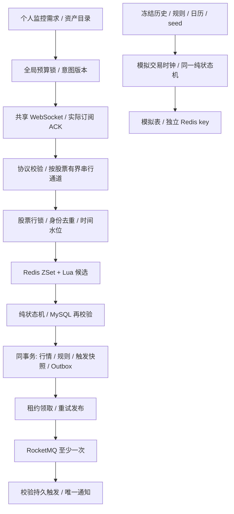

# PricePulse V2.1 最终架构

V2.1 封版说明，2026-10-30。实现与测试以当前源码为准，正式加载及供应商验收事实见 [最终交付](v2.1-final-delivery.md)。产品是实时价格提醒与隔离实验系统，没有交易下单。

## 模块与事实边界

模块化单体：Spring Boot／MyBatis／MySQL 保存业务事实，Redis 是可重建候选索引，RocketMQ 承接已提交的正式提醒；Vue 3 调用本机 REST API。单个正式后端管理一条 Alpaca IEX WebSocket，多用户共享代码集合，不为每个用户开连接。

MySQL、Redis 和 MQ 没有跨系统全局事务。本项目使用事务 Outbox、派生索引 token 与幂等消费分别处理边界，不宣称全局 exactly-once。按股票串行／行锁适合本项目规模，单只热门股票的锁竞争是明确扩展限制。

## Redis 区间候选与价格精度

核心入口：[ThresholdIndex](../src/main/java/com/ezra/pricepulse/matching/ThresholdIndex.java)、[RuleIndex](../src/main/java/com/ezra/pricepulse/matching/RuleIndex.java)、[PriceTicks](../src/main/java/com/ezra/pricepulse/common/PriceTicks.java)。

- 价格最多四位小数，转换整数 tick；四个分段编码 ACTIVE 上破／下破与 COOLDOWN 对应重新激活条件。所有 score 小于 2^52，避免 Redis double 表示整数时丢精度。
- 上涨查询 `(previous, current]`，下跌查询 `[current, previous)`；Lua 一次验证索引 token 并查询所需分段，不把股票全部规则拉回 Java。
- Redis 返回候选 ID，数据库加载当前规则并执行状态机，不能把缓存命中等同业务生效。
- 规则／状态修改推进 MySQL token，并以 Lua 条件更新派生索引。Redis 缺失、过期或数据库事务回滚留下不同 token 时，下次按数据库重建；Redis 不可用则失败并回滚业务，允许同请求重试，避免静默漏判。

`ZRANGEBYSCORE` 的收益取决于候选数量：稀疏候选可以减少读取，密集触发仍须逐条写事务，不能把候选微基准当成整链路吞吐。

## 规则状态与正式行情事务

核心入口：[RuleTransitionEngine](../src/main/java/com/ezra/pricepulse/alert/RuleTransitionEngine.java)、[AlertEvaluationService](../src/main/java/com/ezra/pricepulse/alert/AlertEvaluationService.java)、[QuoteIngestionService](../src/main/java/com/ezra/pricepulse/market/QuoteIngestionService.java)。

| 当前状态 | 判断 | 结果 |
| --- | --- | --- |
| ACTIVE／ABOVE | `previous < threshold && current >= threshold` | ONCE→COMPLETED；REPEAT→COOLDOWN |
| ACTIVE／BELOW | `previous > threshold && current <= threshold` | 同上 |
| COOLDOWN／ABOVE | `current <= rearmPrice` | ACTIVE，仅重新激活 |
| COOLDOWN／BELOW | `current >= rearmPrice` | ACTIVE，仅重新激活 |
| PAUSED／COMPLETED／DELETED | 不参与有效候选 | 不触发 |

同一点只执行一次状态分支，不能重新激活后在同一点再次触发。真实处理在股票行锁下顺序判断：身份去重→时间有效性／水位→基线或正常匹配→更新规则→保存实际成交和触发快照→写 Outbox→更新价格与水位，一起提交。失败不能留下已触发规则而没有通知任务的半状态。规则编辑也遵守相同股票锁顺序并校验版本。

原始时间身份保留纳秒，接纳序号每股递增。不同成交可有相同时间戳，不能仅凭时间相同去重；比水位更早的成交不倒退正式价格。历史缓存查询与模拟不允许进入该 REAL 接口。

## 行情接入、缺口和开盘

核心入口：[AlpacaStream](../src/main/java/com/ezra/pricepulse/market/AlpacaStream.java)、[RealMarketRuntime](../src/main/java/com/ezra/pricepulse/market/RealMarketRuntime.java)、[MarketQuoteLane](../src/main/java/com/ezra/pricepulse/market/MarketQuoteLane.java)、[OpeningGapPolicy](../src/main/java/com/ezra/pricepulse/market/OpeningGapPolicy.java)。

协议处理验证账户／feed、成交条件与正常交易时段；每股单线程有界队列隔离慢处理。断线、客户端暂停、队列溢出和处理失败使该股连续性失效，丢弃不可信尾段；恢复首笔只更新基线，不追补历史穿越。心跳、连接代次、错误历史与时间缺口可观察。

正常交易日切换与故障恢复分别判断。仅同一连续接收代次、相邻有效交易日、可信上一交易日末分钟收盘与完整查询覆盖满足时，才允许开盘首笔按参考收盘穿越；规则还须在开盘前有效。保存 `OPENING_GAP`、实际成交价、真实事件时间及参考来源／修订，不伪造阈值成交。缺少任一条件退回基线策略。

IEX 是单交易所数据。历史分钟稀疏、缓存未覆盖与停市必须区分；不补造分钟、不用断轴掩盖数据不足。现有主动关闭握手 1006 是保留的外部问题，新的进程计数为零不代表已经修复。

## 多用户共享监控与异步协调

核心入口：[MonitoringService](../src/main/java/com/ezra/pricepulse/monitoring/MonitoringService.java)、[DynamicSubscriptionTransport](../src/main/java/com/ezra/pricepulse/monitoring/DynamicSubscriptionTransport.java)、[AlpacaSubscriptions](../src/main/java/com/ezra/pricepulse/market/AlpacaSubscriptions.java)、[MonitoringAccess](../src/main/java/com/ezra/pricepulse/monitoring/MonitoringAccess.java)。

V9 追加资产缓存、个人订阅、全局目标和预算控制表，保持原股票 ID；只为迁移时旧用户一次性建立原十五股需求。新用户默认空列表，重启／登录不补回取消项目。V10 追加全局 `intent_version`，与普通观察版本分开。预算当前为 15 个不同代码，并非已经验证账户支持更多。

1. 搜索调用后端缓存的 Alpaca 资产目录；添加验证真实资产，MySQL 股票／预算锁下保存本人期望并预留唯一代码名额。
2. 网络效果在数据库事务外协调；只有当前连接、当前意图实际 ACK 且正式处理开启，才能显示 CONFIRMED。数据库旧 CONFIRMED 不跨重启直接信任。
3. 同股多用户需求归并成一个上游订阅。失败可见，未知结果保持预留；取消／重加或旧连接迟到 ACK 不能确认新意图。
4. 取消前返回版本和规则集合摘要，用户明确确认后，同事务取消本人需求、软删除本人该股全部未删除规则并更新索引 token；其他账户不变，历史触发／通知保留。并发规则编辑要求重新确认。
5. 最后一项需求取消后才发退订，实际确认不存在后才释放名额。原十五股兼容持有仅在实际确认及无孤立有效规则时接管。
6. 重启依据持久需求重建集合；新加入股票首笔建立新基线，无关股票连续性不因单股增删失效。有效规则创建／恢复须满足本人监控资格。

REST 成功表示期望已保存，不等于上游已确认；UI 必须区分订阅中、监控中、失败和行情恢复状态。

## Outbox、RocketMQ 与通知幂等

核心入口：[OutboxWriter](../src/main/java/com/ezra/pricepulse/outbox/OutboxWriter.java)、[OutboxDispatchService](../src/main/java/com/ezra/pricepulse/outbox/OutboxDispatchService.java)、[RocketMqOutboxPublisher](../src/main/java/com/ezra/pricepulse/outbox/RocketMqOutboxPublisher.java)、[NotificationService](../src/main/java/com/ezra/pricepulse/notification/NotificationService.java)。

- 触发与 Outbox 同事务，唯一业务关联避免一触发多任务。发布者短事务租约领取，事务外发送；成功标 SENT，失败退避，过期租约可恢复。
- 发送成功但本地标记失败可能重投，因此 MQ 按至少一次处理。消费者核对 MySQL 触发、所属用户／股票／规则及 REAL 来源，以 `trigger_id` 唯一约束插入通知。
- 取消监控不删除已提交触发或 Outbox；取消前产生的任务仍可正常到达。历史 LEGACY 记录保留，但旧来源消息不再生成新的正式通知。
- 现阶段没有邮件／短信／交易下单，也没有多节点性能或跨地域容灾承诺。异常积压必须可见，不能将最终一致性解释为每条毫秒送达。

## 模拟隔离、幂等与跳空

核心入口：[SimulationService](../src/main/java/com/ezra/pricepulse/simulation/SimulationService.java)、[SimulationIsolationService](../src/main/java/com/ezra/pricepulse/simulation/SimulationIsolationService.java)、[SimulationOpeningGap](../src/main/java/com/ezra/pricepulse/simulation/SimulationOpeningGap.java)、[SimulationCalendar](../src/main/java/com/ezra/pricepulse/simulation/SimulationCalendar.java)。

开始时冻结规则定义、历史前缀、交易日历和 seed。未暂停规则按产品约定从 ACTIVE 初始化，PAUSED 不参与，不借用真实运行状态。按用户保存最近一次明确创建的实验，切换股票不删除实验，新实验替换旧实验需现有确认。

复用纯 `RuleTransitionEngine` 与 `ThresholdIndex`，使用 `pricepulse:v2:sim:rules:{run:...}` 和独立模拟表；没有生产 Outbox 发布器或正式通知写入。批次以请求 key／hash、实验版本和批次序号幂等，重复开盘请求返回原单点批次，冲突参数拒绝；旧生成器恢复语义保留。

跳空参考可以是真实历史收盘或明确标 SIMULATION 的自定义价格。下一有效开盘只生成一个离散点，周末／节假日／提前收市按冻结日历跳过；后续继续 60 个交易分钟。跳空后 COOLDOWN／重新激活仍由同一状态机决定，不伪造供应商连接或休市成交。

前端真实与模拟复用 [PriceSparkline](../frontend/src/components/PriceSparkline.vue) 与交易时间映射：固定 hover 面板、真实时间戳、休市断轴、跳空衔接和多规则阈值；勾选仅控制显示，事件定位独立于阈值勾选。

## 安全、验证与扩展边界

JWT／BCrypt 与本人资源校验，供应商和 AI Key 仅后端私人配置。AI 只生成经 schema 与服务端校验的规则草稿，用户确认才保存，不参与行情判定。私人配置、备份、原始诊断与构建产物不入库。

134 单元、115 不同集成、65 前端／离线探针及类型／构建已通过；测试含真实临时 MySQL／Redis／RocketMQ、Broker 故障、进程恢复、迁移恢复演练和真实／模拟交叉隔离。合成协议帧验证软件机制，不能替代账户权限、自然成交、连续跨日跳空或长时间运行验收。

性能数据与机器／样本口径见 [求职总结](v2.1-career-summary.md)；供应商外部项、正式数据恢复边界和维护偏差见 [交付记录](v2.1-final-delivery.md)。封版后不扩展为分布式撮合／交易系统。

封版后的性能验证补充（2026-10-31）：新增 [MySQL B+ 树与固定回放对照](performance/v2.1-rule-selection-2026-10-31/report.md)，未改业务架构。实验量化了规则 SELECT 减少与非空回查成本；本次负载的 Redis 选择层整体更慢，不能仅凭热候选微基准推断正式链路加速。
